<p align="center">
  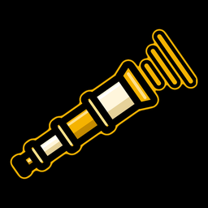
</p>

<h1 align="center">Quartermaster</h1>

<p align="center">
  <b>The Wi-Fi and Bluetooth wardriver for the M5Stack CardputerZero.</b><br>
  Every USB adapter at once. Clean WiGLE logs. Automatic uploads. Recon.
</p>

<p align="center">
  <a href="https://github.com/valleytechsolutions/Quartermaster/releases/latest"></a>
  <a href="https://github.com/valleytechsolutions/Quartermaster/actions/workflows/ci.yml"></a>
  <a href="LICENSE"></a>
</p>

<p align="center">
  
  
</p>

Plug in any USB Wi-Fi adapter and any GPS, press one key, and drive. Quartermaster finds your hardware by itself, scans on every radio at the same time, counts each network once, and writes logs in exactly the format WiGLE expects. When the Cardputer is back online, the log goes to WiGLE, WDGWars and Wardrift on its own.

## What it does

- **Every adapter at once.** Single, dual or tri-band, on the USB-A or the USB-C port, through a hub or not. Each adapter scans in its own thread across 2.4, 5 and 6 GHz, next to the built-in radio and Bluetooth. Plug one in or pull one out in the middle of a wardrive and it joins or leaves.
- **A full wardriver with no adapter at all.** The built-in 2.4 GHz radio, Bluetooth and a GPS are enough.
- **GPS from anything.** A USB receiver, the Cap LoRa-1262, a Grove GPS unit or gpsd. It is found by itself, and the cap and Grove port are powered on when a GPS is needed there.
- **The closest and the furthest sighting, and nothing else.** Each device is listed once. Its strongest and its weakest sighting are written with their exact positions, and by default no other rows, so a log holds no pile of repeats.
- **Logs WiGLE accepts.** WigleWifi-1.6 CSV, written only with a fresh GPS fix and a real clock, split into files every upload site takes. Each log names Quartermaster in its header.
- **Uploads by themselves.** Finished logs go to WiGLE, WDGWars and Wardrift whenever the Cardputer is online. Every log shows what each site did with it.
- **Keys from your phone.** Scan a QR code, enter the PIN, paste your keys. Or type them on the keyboard. Each key can be tested from the device.
- **Recon.** A separate mode that watches for ALPR and Flock cameras, body cameras, doorbell and security cameras, camera glasses, trackers such as AirTag and SmartTag, Remote ID drones and more. It grades the evidence, warns you, tells you if a device seems to follow you, and has a signal finder to walk it down.
- **Nodes.** Small ESP32-C5 boards scan beside your adapters, on USB or wireless through a hub node. Quartermaster shares the channels out between them.
- **Aircraft.** With an RTL-SDR stick and readsb, the aircraft around you are logged for WDGWars and Wardrift.
- **One at a time.** Recon and a wardrive never run together, so every radio is always doing one job well.
- **The battery in view.** The level is at the top of every screen. Quartermaster tells you at 20 % and at 10 %. When the battery is almost empty, it saves a running wardrive and closes, so that the Cardputer can switch off safely.

## Screens

<table>
  <tr>
    <td></td>
    <td></td>
    <td>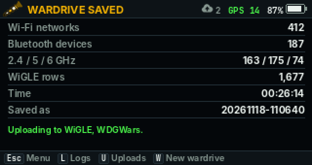</td>
  </tr>
  <tr>
    <td align="center">Menu</td>
    <td align="center">Wardrive</td>
    <td align="center">Summary</td>
  </tr>
  <tr>
    <td></td>
    <td></td>
    <td>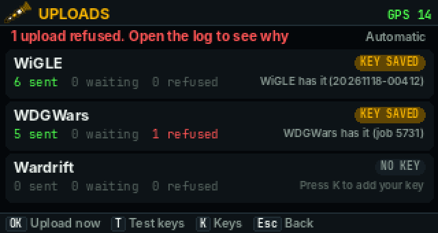</td>
  </tr>
  <tr>
    <td align="center">Hardware</td>
    <td align="center">Logs, with a dot per upload site</td>
    <td align="center">Uploads</td>
  </tr>
  <tr>
    <td>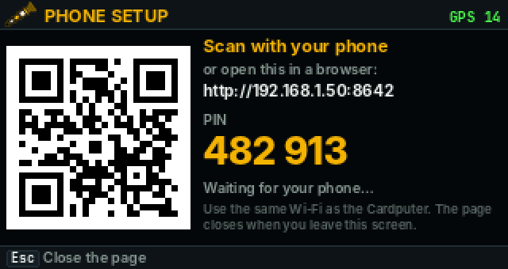</td>
    <td>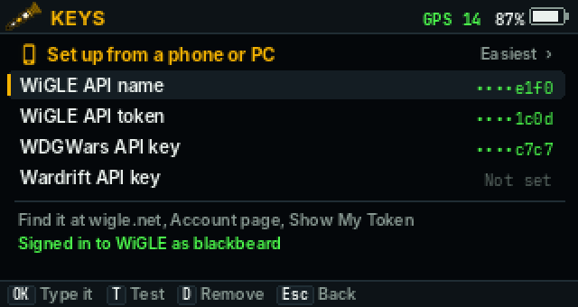</td>
    <td>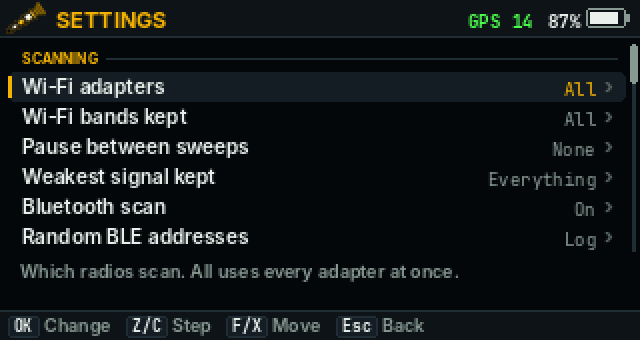</td>
  </tr>
  <tr>
    <td align="center">Phone setup</td>
    <td align="center">Keys</td>
    <td align="center">Settings</td>
  </tr>
  <tr>
    <td></td>
    <td></td>
    <td></td>
  </tr>
  <tr>
    <td align="center">Recon</td>
    <td align="center">Device details</td>
    <td align="center">Signal finder</td>
  </tr>
</table>

## Install

### From the CardputerZero AppStore

Search for **Quartermaster**, or enter the share code **WARD**. The listing is in review. Until it is approved, use the command below.

### With one command

Open a terminal on the CardputerZero, or connect to it with SSH, and paste this:

```sh
wget -qO /tmp/quartermaster.deb https://github.com/valleytechsolutions/Quartermaster/releases/latest/download/quartermaster.deb && sudo apt install -y /tmp/quartermaster.deb
```

Restart the Cardputer once after the first install, then open **Quartermaster** from the launcher.

The same command updates it. To remove it: `sudo apt remove quartermaster`. Your logs and settings stay where they are.

**Settings > Check for updates** tells you when a newer version is out. It only asks the AppStore and GitHub, and never downloads anything. An app from the AppStore is updated in the AppStore app on the Cardputer: it lists the apps with a newer version, and key 7 updates them.

## Your first wardrive

1. Plug in your GPS, and any Wi-Fi adapters you have.
2. Open Quartermaster and, when the menu shows, press **H**. Every adapter is listed with its bands, and the GPS line turns green when it has a fix.
3. Press **Esc** to go back to the menu, then **W**. The three counters show Wi-Fi networks, Bluetooth devices and rows logged.
4. Press **OK**, and **OK** again to confirm. The wardrive stops, the log is saved and, if you have added keys, sent.

Rows are only written while the GPS has a fix. Without one, the screen tells you and keeps counting.

## Upload keys

Each site gives you a key on its own website. Quartermaster never asks for your password.

| Site | Where to find the key |
| --- | --- |
| [WiGLE](https://wigle.net) | Account page, then **Show My Token**. You need both the API Name and the API Token. |
| [WDGWars](https://wdgwars.pl) | Profile, then **Generate API key**. |
| [Wardrift](https://wardrift.net) | Dashboard, then **API Keys**. |

**From your phone or PC (easiest).** From the menu, press **K**, then **OK** on the first row. Scan the QR code, or open the address on the screen in a browser, and enter the PIN. Paste your keys and press Save. The page also lets you download logs and paste a list of networks to leave out. It only exists while that screen is open, on your own network, and it never shows a saved key in full, only its last four characters.

**On the Cardputer.** From the menu, press **K**, pick a key, press **OK** and type it. Press **T** to test it. A symbol is typed with **Sym** and the key it is printed on, or picked from the list that **Tab** opens.

Use any one site, or all three. Keys are stored on the device in a file only your user can read.

## Hardware

- **Wi-Fi adapters:** any USB adapter with a driver in the CardputerZero's Linux kernel. That covers the common MediaTek, Realtek, Ralink and Atheros chips, including MT7921AU tri-band adapters such as the ALFA AWUS036AXM.
- **GPS:** any USB receiver that sends NMEA (u-blox, Quectel LC29H and others), the Cap LoRa-1262, a Grove GPS unit, or gpsd.
- **Bluetooth:** the built-in radio.
- **Nodes:** ESP32-C5 boards running the Quartermaster Node firmware. See [Nodes](#nodes).
- **Aircraft:** an RTL-SDR stick (RTL2832U). See [Aircraft](#aircraft).

Recommended:

- **Wi-Fi:** the [AC1200 USB-C WiFi Card](https://hackergadgets.com/products/ac1200-usb-c-wifi-card) from HackerGadgets, a tri-band MT7921AU adapter for 2.4, 5 and 6 GHz with a USB-C connector.
- **GPS:** the Dual Band GNSS USB Dongle from [AWOK Dynamics](https://awokdynamics.com).

Tested on a CardputerZero with an ALFA AWUS036AXM and the HackerGadgets AC1200 scanning together, and an LC29H USB GPS.

Tri-band adapters draw a lot of power. If the Hardware screen says an adapter is on USB but not starting, replug it, try the other port, or use a powered hub. One ALFA AWUS036AXML did not start on the test device.

## Nodes

A Quartermaster Node is a small ESP32-C5 board on USB that scans Wi-Fi on 2.4 and 5 GHz, and Bluetooth when you ask, beside your adapters. Quartermaster shares the channels out between the nodes, so with more nodes each channel is heard more often. Up to 8 nodes can be used at once.

These boards are supported:

- **Seeed XIAO ESP32-C5**
- **Espressif ESP32-C5-DevKitC-1**, with a chip of revision v1.0 or later. Early boards carry a v0.1 sample chip, which cannot run the node firmware.
- **M5Stack Stamp-C5**

Other ESP32-C5 boards with 4 MB of flash or more may work too.

1. Plug the board in. If it already runs the node firmware, Quartermaster says **New node found**. If not, flash it first (see below).
2. Open **Settings > Nodes** and press **OK** on the new node to add it. It scans in every wardrive and in Recon from then on.
3. Press **OK** on a node to rename it, turn its Bluetooth on (that halves its time for Wi-Fi), tell it which light the board has, blink that light, update its firmware or remove it. A node uses no light until you choose one.

Set **Settings > Country** to where you are: the nodes only use the Wi-Fi channels allowed there. Quartermaster asks the first time you open **Settings > Nodes**. Until then it uses United States. The Hardware screen has a card for each node with the channels it scans.

If gpsd is installed, plug a node in by its own USB port, not a UART port. gpsd may take a UART port for a GPS.

### Wireless nodes

Nodes do not have to be plugged in. One node stays on the CardputerZero as the **hub**, and up to 8 more run on a battery or a USB charger and send what they hear to the hub by radio. Each wireless node scans its own share of the channels where it is, within radio range of the hub.

1. Open the node that stays plugged in and turn on **Hub for wireless nodes**. The hub does not scan. There is one hub: turning it on for one node turns it off for the others. It needs node firmware 1.1.0 or later.
2. In **Settings > Nodes**, choose **Add a wireless node**. Pairing stays open for 60 seconds. Press **OK** to open it again.
3. Power the new node from a battery or a USB charger, not from the Cardputer, and hold its **BOOT** button for 2 seconds (on a Stamp-C5, hold G28 to GND). It shows up as **New wireless node**. Press **OK** to add it.

Wireless nodes start and stop with every wardrive and Recon. A wireless node's screen and the Hardware screen say when it was last heard and how well the hub hears it. A node that has not been heard for 30 seconds hands its channels to the others and gets them back when it is heard again. When the hub is unplugged, the wireless nodes wait for it and the nodes on USB scan every channel. Removing a wireless node makes the hub forget it; hold BOOT on it to add it again. A wireless node plugged in by USB scans as a USB node until it is unplugged. Moving the hub to another node means adding every wireless node again: Quartermaster asks first, and each one says so until it is added.

A wireless node is somewhere within radio range of the hub, not at the Cardputer. So its rows get the Cardputer's position from when the node heard the device, with an accuracy 50 m wider. They are never used as a device's furthest row.

### Flashing a node

**From the Cardputer.** Plug the board in and open **Settings > Flash a node**. Pick the board. A board without the node firmware gets **Install**, which erases it. A node you already have can choose **Update**, which keeps its settings, or **First install**. A progress bar shows how far it is. A node whose firmware is older than the one that came with Quartermaster also shows **Update firmware** on its screen in **Settings > Nodes**.

**From a computer or a phone.** The flasher web page in [docs/flasher](docs/flasher/) works in Chrome or Edge on a computer, or Chrome on Android. Plug the board in, press **First install** for a new board, or **Update, keep settings** for a board that already runs Quartermaster Node, and pick the board in the list. It needs https, so open it from GitHub Pages, not as a file. Safari and the browsers on iPhone and iPad cannot flash a board.

Flashing from the Cardputer waits until no wardrive or Recon runs. If a board does not answer, put it in download mode and try again:

- **Seeed XIAO ESP32-C5:** hold BOOT while you plug it in.
- **M5Stack Stamp-C5:** hold G28 to GND while you plug it in.
- **ESP32-C5-DevKitC-1:** hold BOOT and press RESET.

<table>
  <tr>
    <td>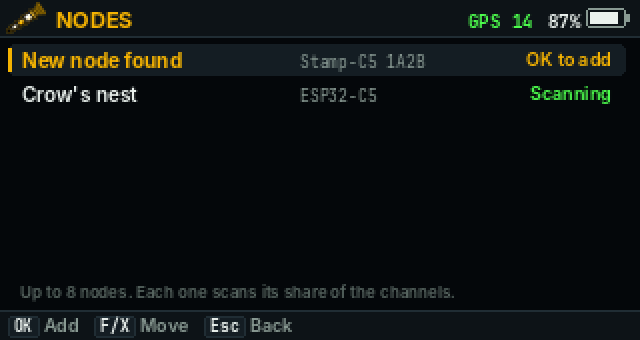</td>
    <td>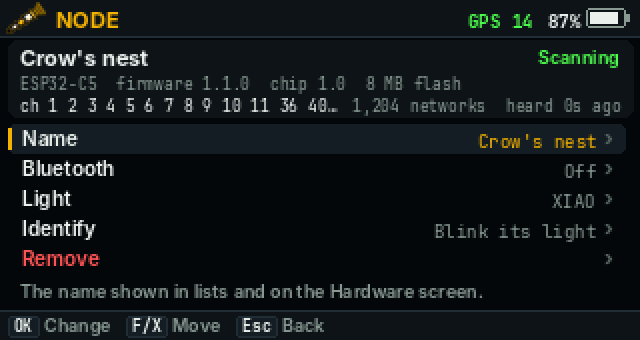</td>
    <td>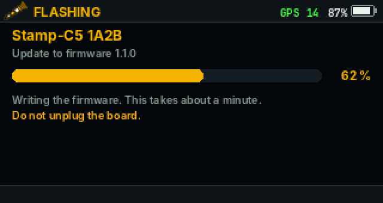</td>
  </tr>
  <tr>
    <td align="center">Nodes</td>
    <td align="center">A node</td>
    <td align="center">Flashing a node</td>
  </tr>
  <tr>
    <td>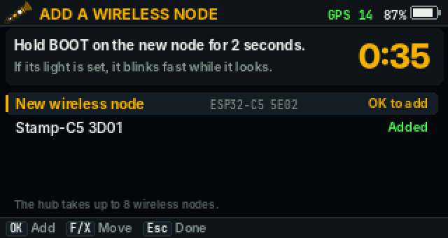</td>
  </tr>
  <tr>
    <td align="center">Adding a wireless node</td>
  </tr>
</table>

The firmware, the boards it runs on and the serial protocol are described in [firmware/README.md](firmware/README.md).

## Aircraft

With an RTL-SDR stick (RTL2832U) on USB, Quartermaster also logs the aircraft around you, for WDGWars and Wardrift. WiGLE does not take aircraft, so they are never sent there.

1. Install the decoder once: `sudo apt install readsb`. Quartermaster never installs anything itself.
   The package may also start readsb at every boot, where it keeps the stick and some CPU all the time. To let Quartermaster run it only during wardrives, turn that off once: `sudo systemctl disable --now readsb`.
2. Turn on **Settings > Aircraft (ADS-B)** and plug in the stick.
3. Start a wardrive. The Wardrive screen counts the aircraft beside the radios, and the Hardware screen shows the stick.

If readsb already runs on the Cardputer as a system service, Quartermaster reads what it writes to `/run/readsb` or `/run/adsb` and does not start a second copy. Otherwise it starts readsb for the wardrive at a low priority on one CPU, with no network ports, and stops it with the wardrive. Without the stick or readsb the wardrive goes on as ever, and the Hardware screen says why. Installing Quartermaster gives the user access to the stick. If the Hardware screen still says there is no permission, restart the Cardputer once.

Each aircraft is kept once, with its closest and its furthest position. When the wardrive stops, `quartermaster_<date>-<time>.aircraft.json.gz` (readsb's own aircraft.json format, at the closest position) is written beside the WiGLE log and goes to WDGWars and Wardrift. Wardrift only gives points for aircraft heard in the last 3 days, so keep uploads on.

<table>
  <tr>
    <td>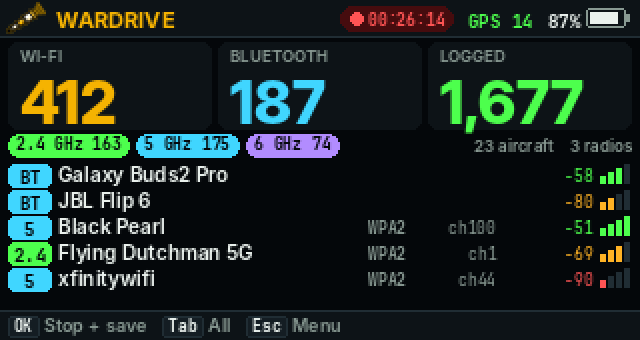</td>
    <td>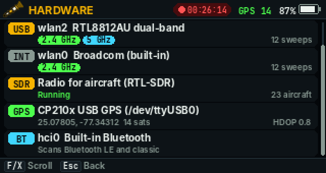</td>
    <td>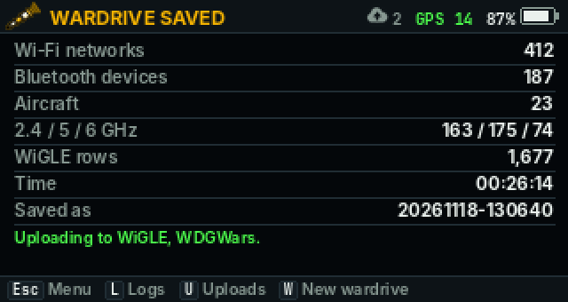</td>
  </tr>
  <tr>
    <td align="center">Wardrive with aircraft</td>
    <td align="center">The stick on the Hardware screen</td>
    <td align="center">Summary</td>
  </tr>
</table>

## Controls

| Key | What it does |
| --- | --- |
| **F X Z C** or the arrows | Up, down, left, right |
| **OK** (Enter) | Open or confirm |
| **Esc** | Back |
| **Space** | Start or stop a wardrive from the menu |
| **W R L U H S K A** | From the menu: jump to Wardrive, Recon, Logs, Uploads, Hardware, Settings, Keys, About |
| **Tab** | On the wardrive screen: show Wi-Fi, Bluetooth or both. In a text box: list every symbol |
| **Sym**, then a key | In a text box: the symbol printed on that key |

Every screen shows its own keys along the bottom.

## Settings

| Section | Setting | Choices | Default |
| --- | --- | --- | --- |
| Scanning | Wi-Fi adapters | All, USB only, Built-in only | All |
| | Wi-Fi bands kept | All, 2.4 GHz, 5 GHz, 6 GHz, 5 + 6 GHz | All |
| | Pause between sweeps | None, 1 s, 3 s, 10 s | None |
| | Weakest signal kept | Everything, -90, -85, -80, -70 dBm | Everything |
| | Bluetooth scan | On, Off | On |
| | Random BLE addresses | Log, Skip | Log |
| | Bluetooth check | 0.5 s, 1 s, 2 s, 5 s | 1 s |
| | Aircraft (ADS-B) | Off, On | Off |
| | Country | 44 countries, or Anywhere else | United States |
| Nodes | Nodes | The nodes in use, and new ones to add | |
| | Flash a node | Install or update the node firmware | |
| Logging | Rows per device | Closest + furthest, Full track | Closest + furthest |
| | Log when signal changes (Full track) | 2, 4, 6, 10 dB | 4 dB |
| | Log again after moving (Full track) | 10, 25, 50, 100 m | 25 m |
| | Shortest time between rows (Full track) | 5, 10, 30, 60 s | 30 s |
| | Hidden networks | Log, Skip | Log |
| | Ignored networks | Names or addresses that are never logged | |
| GPS | GPS source | Auto, gpsd, USB, Cap / Grove, Off | Auto |
| | GPS accuracy needed | Any fix, Fair, Good, Best | Any fix |
| | Cap and Grove power | When needed, Leave off | When needed |
| Uploads | Send logs | Automatic, Only when asked | Automatic |
| Recon | Show devices from | Weak hints, Medium evidence, Strong only | Weak hints |
| | Alert from | Weak hints, Medium evidence, Strong only | Medium evidence |
| | Alert sound | On, Off | On |
| | Watch list | The kinds of device Recon looks for | All |
| Screen | Live list shows | Wi-Fi + BLE, Wi-Fi, Bluetooth | Wi-Fi + BLE |
| | Start wardrive on launch | No, Yes | No |
| | Boot animation | On, Off | On |
| About | Check for updates | Asks the AppStore and GitHub | |

## Logs

Everything is kept in the `quartermaster` folder in your home directory.

| File | What it is |
| --- | --- |
| `logs/quartermaster_<date>-<time>.wigle.csv` | The wardrive in WigleWifi-1.6 format, ready for WiGLE, WDGWars and Wardrift. |
| `logs/quartermaster_<date>-<time>.summary.csv` | One line per device: name, security, channel, first and last seen, and the strongest and weakest sighting with position and time. |
| `logs/quartermaster_<date>-<time>.aircraft.json.gz` | The aircraft of the wardrive, each at its closest position, for WDGWars and Wardrift. |
| `logs/quartermaster_<date>-<time>.aircraft.csv` | One line per aircraft: callsign, squawk, first and last seen, signal, and the closest and furthest position with height, speed and time. |
| `recon/recon_<date>-<time>.jsonl` | What Recon flagged. |

Every log starts with a header that names the app:

```
WigleWifi-1.6,appRelease=Quartermaster 1.1.0,model=CardputerZero,release=...,device=Quartermaster,display=320x170,board=M5Stack CardputerZero,brand=Valleytech Solutions,star=Sol,body=3,subBody=0
```

By default each device has at most two rows in a log: its strongest sighting, the closest pass, and its weakest, the far edge of its range, each with its own position and time. A weak sighting below -92 dBm, or with a position less sure than 25 m, is not used as the far edge. One row is written when there is nothing better. Until the wardrive stops, the rows wait in a hidden file next to the log, so the log appears in Logs and goes to the upload sites once the wardrive stops. After a crash or a power cut, Quartermaster finishes that log the next time it opens.

With **Rows per device** set to **Full track**, a device also gets a new row when its signal is stronger or weaker than anything logged so far, or when you have moved and enough time has passed. Its exact strongest and weakest sightings are always in the file by the time the wardrive ends.

A log is split at 8 MB so that every site accepts it.

To copy logs off the Cardputer, open the phone setup page and tap a log, or use SFTP.

## Recon

Recon listens on every radio for devices that look like surveillance or tracking equipment. Each match is graded as a weak hint, medium evidence or a strong signature, and the details screen shows exactly what was matched. Press **OK** on a device and **OK** again to open the signal finder, then walk toward the stronger signal.

A match is broadcast evidence. It is not proof that a device is recording, who owns it, or what it is for. Many products share radio parts, so weak hints are common.

## Good to know

- Quartermaster only scans. It never joins a network and never pairs with a Bluetooth device.
- Record only what is legal where you are, and respect the terms of the sites you upload to.
- The phone setup page uses plain HTTP on your local network, protected by a PIN that changes every time. Open it on a network you trust.
- Network and device names are whatever their owners made them. Quartermaster treats everything it hears as untrusted, and a broken broadcast cannot stop a wardrive.
- If something does go wrong, the reason is written to `~/quartermaster/errors.log`. Attach that file when you report a problem.

## Build it yourself

```sh
git clone https://github.com/valleytechsolutions/Quartermaster
cd Quartermaster
python3 -m pip install pillow numpy pyserial pytest
python3 -m pytest tests
python3 tools/build_deb.py
```

The package lands in `build/`. That last step needs `dpkg-deb`, so run it on Debian, Ubuntu or the Cardputer itself. `python3 tools/render_screens.py` draws every screen with sample data, which is how the pictures on this page are made.

On the Cardputer, `/usr/share/APPLaunch/bin/quartermaster --probe` lists the adapters and GPS ports it can see.

## Thanks

Thanks to [AWOK Dynamics](https://awokdynamics.com) and [HackerGadgets](https://hackergadgets.com).

## License

MIT. Made by [Valleytech Solutions](https://github.com/valleytechsolutions).

The Inter and JetBrains Mono fonts are included under the SIL Open Font License. Their license files are next to the fonts.

The Quartermaster Node firmware images include ESP-IDF and other open source parts. Their licenses are in [quartermaster/assets/node-firmware-notices.txt](quartermaster/assets/node-firmware-notices.txt).
