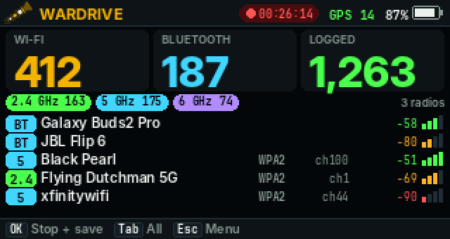
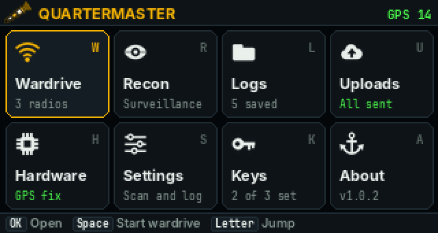
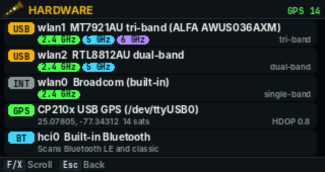
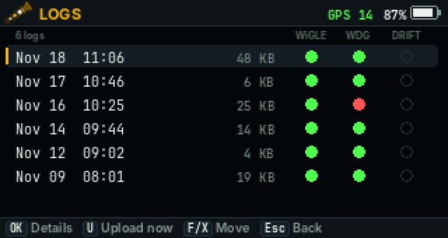
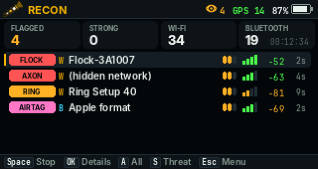
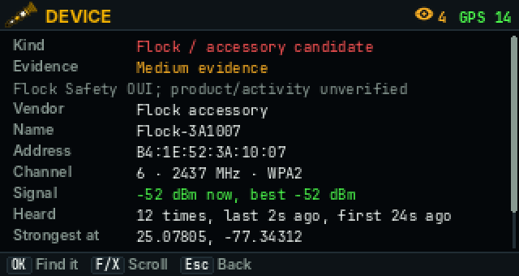
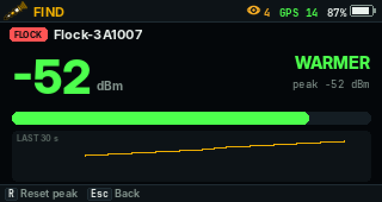

<p align="center">
  
</p>

<h1 align="center">Quartermaster</h1>

<p align="center">
  <b>The Wi-Fi and Bluetooth wardriver for the M5Stack CardputerZero.</b><br>
  Every USB adapter at once. Clean WiGLE logs. Automatic uploads. Recon.
</p>

<p align="center">
  <a href="https://github.com/valleytechsolutions/Quartermaster/releases/latest"></a>
  <a href="https://github.com/valleytechsolutions/Quartermaster/actions/workflows/ci.yml"></a>
  <a href="LICENSE"></a>
</p>

<p align="center">
  
  
</p>

Plug in any USB Wi-Fi adapter and any GPS, press one key, and drive. Quartermaster finds your hardware by itself, scans on every radio at the same time, counts each network once, and writes logs in exactly the format WiGLE expects. When the Cardputer is back online, the log goes to WiGLE, WDGWars and Wardrift on its own.

## What it does

- **Every adapter at once.** Single, dual or tri-band, on the USB-A or the USB-C port, through a hub or not. Each adapter scans in its own thread across 2.4, 5 and 6 GHz, next to the built-in radio and Bluetooth. Plug one in or pull one out in the middle of a wardrive and it joins or leaves.
- **A full wardriver with no adapter at all.** The built-in 2.4 GHz radio, Bluetooth and a GPS are enough.
- **GPS from anything.** A USB receiver, the Cap LoRa-1262, a Grove GPS unit or gpsd. It is found by itself, and the cap and Grove port are powered on when a GPS is needed there.
- **The closest and the farthest sighting, always.** Each device is listed once, and both its strongest and its weakest sighting are written with their exact positions.
- **Logs WiGLE accepts.** WigleWifi-1.6 CSV, written only with a fresh GPS fix and a real clock, split into files every upload site takes. Each log names Quartermaster in its header.
- **Uploads by themselves.** Finished logs go to WiGLE, WDGWars and Wardrift whenever the Cardputer is online. Every log shows what each site did with it.
- **Keys from your phone.** Scan a QR code, enter the PIN, paste your keys. Or type them on the keyboard. Each key can be tested from the device.
- **Recon.** A separate mode that watches for ALPR and Flock cameras, body cameras, doorbell and security cameras, camera glasses, trackers such as AirTag and SmartTag, Remote ID drones and more. It grades the evidence, warns you, tells you if a device seems to follow you, and has a signal finder to walk it down.
- **One at a time.** Recon and a wardrive never run together, so every radio is always doing one job well.

## Screens

<table>
  <tr>
    <td></td>
    <td></td>
    <td></td>
  </tr>
  <tr>
    <td align="center">Menu</td>
    <td align="center">Wardrive</td>
    <td align="center">Summary</td>
  </tr>
  <tr>
    <td></td>
    <td></td>
    <td></td>
  </tr>
  <tr>
    <td align="center">Hardware</td>
    <td align="center">Logs, with a dot per upload site</td>
    <td align="center">Uploads</td>
  </tr>
  <tr>
    <td></td>
    <td></td>
    <td></td>
  </tr>
  <tr>
    <td align="center">Phone setup</td>
    <td align="center">Keys</td>
    <td align="center">Settings</td>
  </tr>
  <tr>
    <td></td>
    <td></td>
    <td></td>
  </tr>
  <tr>
    <td align="center">Recon</td>
    <td align="center">Device details</td>
    <td align="center">Signal finder</td>
  </tr>
</table>

## Install

### From the CardputerZero App Store

Search for **Quartermaster**, or enter the share code **WARD**. The listing is in review. Until it is approved, use the command below.

### With one command

Open a terminal on the CardputerZero, or connect to it with SSH, and paste this:

```sh
wget -qO /tmp/quartermaster.deb https://github.com/valleytechsolutions/Quartermaster/releases/latest/download/quartermaster.deb && sudo apt install -y /tmp/quartermaster.deb
```

Restart the Cardputer once after the first install, then open **Quartermaster** from the launcher.

The same command updates it. To remove it: `sudo apt remove quartermaster`. Your logs and settings stay where they are.

## Your first wardrive

1. Plug in your GPS, and any Wi-Fi adapters you have.
2. Open Quartermaster and press **H**. Every adapter is listed with its bands, and the GPS line turns green when it has a fix.
3. Press **W**. The three counters show Wi-Fi networks, Bluetooth devices and rows logged.
4. Press **OK** to stop. The log is saved and, if you have added keys, sent.

Rows are only written while the GPS has a fix. Without one, the screen tells you and keeps counting.

## Upload keys

Each site gives you a key on its own website. Quartermaster never asks for your password.

| Site | Where to find the key |
| --- | --- |
| [WiGLE](https://wigle.net) | Account page, then **Show My Token**. You need both the API Name and the API Token. |
| [WDGWars](https://wdgwars.pl) | Profile, then **Generate API key**. |
| [Wardrift](https://wardrift.net) | Dashboard, then **API Keys**. |

**From your phone or PC (easiest).** Press **K**, then **OK** on the first row. Scan the QR code, or open the address on the screen in a browser, and enter the PIN. Paste your keys and press Save. The page also lets you download logs and paste a list of networks to leave out. It only exists while that screen is open, on your own network, and it never shows a saved key.

**On the Cardputer.** Press **K**, pick a key, press **OK** and type it. Press **T** to test it. A symbol is typed with **Sym** and the key it is printed on, or picked from the list that **Tab** opens.

Use any one site, or all three. Keys are stored on the device in a file only your user can read.

## Hardware

- **Wi-Fi adapters:** any USB adapter with a driver in the CardputerZero's Linux kernel. That covers the common MediaTek, Realtek, Ralink and Atheros chips, including MT7921AU tri-band adapters such as the ALFA AWUS036AXM.
- **GPS:** any USB receiver that sends NMEA (u-blox, Quectel LC29H and others), the Cap LoRa-1262, a Grove GPS unit, or gpsd.
- **Bluetooth:** the built-in radio.

Tested on a CardputerZero with an ALFA AWUS036AXM and a second MT7921AU adapter scanning together, and an LC29H USB GPS.

Tri-band adapters draw a lot of power. If the Hardware screen says an adapter is on USB but not starting, replug it, try the other port, or use a powered hub. One ALFA AWUS036AXML did not start on the test device.

## Controls

| Key | What it does |
| --- | --- |
| **F X Z C** or the arrows | Up, down, left, right |
| **OK** (Enter) | Open or confirm |
| **Esc** | Back |
| **Space** | Start or stop a wardrive from the menu |
| **W R L U H S K A** | Jump to Wardrive, Recon, Logs, Uploads, Hardware, Settings, Keys, About |
| **Tab** | On the wardrive screen: show Wi-Fi, Bluetooth or both. In a text box: list every symbol |
| **Sym**, then a key | In a text box: the symbol printed on that key |

Every screen shows its own keys along the bottom.

## Settings

| Section | Setting | Choices | Default |
| --- | --- | --- | --- |
| Scanning | Wi-Fi adapters | All, USB only, Built-in only | All |
| | Wi-Fi bands kept | All, 2.4 GHz, 5 GHz, 6 GHz, 5 + 6 GHz | All |
| | Pause between sweeps | None, 1 s, 3 s, 10 s | None |
| | Weakest signal kept | Everything, -90, -85, -80, -70 dBm | Everything |
| | Bluetooth scan | On, Off | On |
| | Random BLE addresses | Log, Skip | Log |
| | Bluetooth check | 0.5 s, 1 s, 2 s, 5 s | 1 s |
| Logging | Log when signal changes | 2, 4, 6, 10 dB | 4 dB |
| | Log again after moving | 10, 25, 50, 100 m | 25 m |
| | Shortest time between rows | 5, 10, 30, 60 s | 30 s |
| | Hidden networks | Log, Skip | Log |
| | Ignored networks | Names or addresses that are never logged | |
| GPS | GPS source | Auto, gpsd, USB, Cap / Grove, Off | Auto |
| | GPS accuracy needed | Any fix, Fair, Good, Best | Any fix |
| | Cap and Grove power | When needed, Leave off | When needed |
| Uploads | Send logs | Automatic, Only when asked | Automatic |
| Recon | Show devices from | Weak hints, Medium evidence, Strong only | Weak hints |
| | Alert from | Weak hints, Medium evidence, Strong only | Medium evidence |
| | Alert sound | On, Off | On |
| | Watch list | The kinds of device Recon looks for | All |
| Screen | Live list shows | Wi-Fi + BLE, Wi-Fi, Bluetooth | Wi-Fi + BLE |
| | Start wardrive on launch | No, Yes | No |
| | Boot animation | On, Off | On |

## Logs

Everything is kept in the `quartermaster` folder in your home directory.

| File | What it is |
| --- | --- |
| `logs/quartermaster_<date>-<time>.wigle.csv` | The wardrive in WigleWifi-1.6 format, ready for WiGLE, WDGWars and Wardrift. |
| `logs/quartermaster_<date>-<time>.summary.csv` | One line per device: name, security, channel, first and last seen, and the strongest and weakest sighting with position and time. |
| `recon/recon_<date>-<time>.jsonl` | What Recon flagged. |

Every log starts with a header that names the app:

```
WigleWifi-1.6,appRelease=Quartermaster 1.0.2,model=CardputerZero,release=...,device=Quartermaster,display=320x170,board=M5Stack CardputerZero,brand=Valleytech Solutions,star=Sol,body=3,subBody=0
```

A device gets a new row when its signal is stronger or weaker than anything logged so far, or when you have moved and enough time has passed. Its exact strongest and weakest sightings are always in the file by the time the wardrive ends. A log is split at 8 MB so that every site accepts it.

To copy logs off the Cardputer, open the phone setup page and tap a log, or use SFTP.

## Recon

Recon listens on every radio for devices that look like surveillance or tracking equipment. Each match is graded as a weak hint, medium evidence or a strong signature, and the details screen shows exactly what was matched. Press **OK** on a device and **OK** again to open the signal finder, then walk toward the stronger signal.

A match is broadcast evidence. It is not proof that a device is recording, who owns it, or what it is for. Many products share radio parts, so weak hints are common.

## Good to know

- Quartermaster only scans. It never joins a network and never pairs with a Bluetooth device.
- Record only what is legal where you are, and respect the terms of the sites you upload to.
- The phone setup page uses plain HTTP on your local network, protected by a PIN that changes every time. Open it on a network you trust.
- Network and device names are whatever their owners made them. Quartermaster treats everything it hears as untrusted, and a broken broadcast cannot stop a wardrive.
- If something does go wrong, the reason is written to `~/quartermaster/errors.log`. Attach that file when you report a problem.

## Build it yourself

```sh
git clone https://github.com/valleytechsolutions/Quartermaster
cd Quartermaster
python3 -m pip install pillow numpy pyserial pytest
python3 -m pytest tests
python3 tools/build_deb.py
```

The package lands in `build/`. That last step needs `dpkg-deb`, so run it on Debian, Ubuntu or the Cardputer itself. `python3 tools/render_screens.py` draws every screen with sample data, which is how the pictures on this page are made.

On the Cardputer, `/usr/share/APPLaunch/bin/quartermaster --probe` lists the adapters and GPS ports it can see.

## License

MIT. Made by [Valleytech Solutions](https://github.com/valleytechsolutions).

The Inter and JetBrains Mono fonts are included under the SIL Open Font License. Their license files are next to the fonts.
