# Build a DIY Quartermaster

This guide is for the DIY version of Quartermaster, which runs on a Raspberry Pi with a Waveshare LCD HAT. If you have an M5Stack CardputerZero, you need the other version: install it from the CardputerZero AppStore (share code **WARD**), and follow the [README](../README.md) and the [user guide](guide/README.md). To tell the two versions apart, see [How the DIY version differs from the CardputerZero](#how-the-diy-version-differs-from-the-cardputerzero).

To build one, you need a Raspberry Pi, one of the two Waveshare joystick HATs that Raspyjack uses, and a GPS. Quartermaster installs on Raspberry Pi OS. If you already use Raspyjack, you can keep its SD card as it is and put Quartermaster on a second card. Then you switch between the two by changing the card.

In this guide:

- [Parts](#parts)
- [Easiest way: flash a ready image](#easiest-way-flash-a-ready-image)
- [Assemble and install manually](#assemble-and-install-manually)
- [Controls](#controls)
- [Screens](#screens)
- [Using Quartermaster on the HAT](#using-quartermaster-on-the-hat)
- [How the DIY version differs from the CardputerZero](#how-the-diy-version-differs-from-the-cardputerzero)
- [Troubleshooting](#troubleshooting)
- [Checking a build](#checking-a-build)

## Parts

| Part | What to use |
| --- | --- |
| Computer | A Raspberry Pi Zero 2 WH, or a Zero 2 W with a soldered 40-pin header. A Pi 3B, 3B+ or 4B has the header too. The original Zero W or WH also works, but it is slower and needs the 32-bit Raspberry Pi OS. |
| Display | One of the two HATs below. Both plug straight onto the 40-pin header and have the joystick and the buttons on them. |
| Storage and power | A microSD card of 8 GB or more, and a power supply or USB battery that is strong enough for the Pi and everything plugged into it. |
| Position | A USB GPS that sends standard NMEA data, or a receiver that runs through `gpsd` on the Pi. Quartermaster writes nothing to a log until the GPS has a fix and knows the time. |
| More radios (optional) | A supported USB Wi-Fi adapter for more bands, Quartermaster nodes on USB, or an RTL-SDR stick for aircraft. A Zero has only one USB port for data. Use an OTG hub to plug in more than one thing, and give the radios enough power. |

### Which HAT do you have?

| Waveshare 1.44inch LCD HAT | Waveshare 1.3inch LCD HAT |
| --- | --- |
| [](https://www.waveshare.com/1.44inch-lcd-hat.htm) | [](https://www.waveshare.com/1.3inch-lcd-hat.htm) |
| A **128×128** screen with an ST7735S chip. Its display setting is `st7735-128`, the default. | A **240×240** screen with an ST7789 chip. Its display setting is `st7789-240`. |
| [1.44inch product gallery](https://www.waveshare.com/1.44inch-lcd-hat.htm) | [1.3inch product gallery](https://www.waveshare.com/1.3inch-lcd-hat.htm) · [1.3inch hardware guide](https://www.waveshare.com/wiki/1.3inch_LCD_HAT) |

The photos by Waveshare show the bare HATs. [Screens](#screens) shows Quartermaster on each one.

The built-in Wi-Fi of a Zero W, Zero 2 W or 3B covers 2.4 GHz. A 3B+ or 4B also covers 5 GHz. For 6 GHz, add a USB adapter that covers it, and check the bands shown under **Hardware**. The [Wi-Fi adapters](guide/wifi-adapters.md) page of the user guide lists the adapters that work. See also the [Pi Zero 2 W specifications](https://www.raspberrypi.com/products/raspberry-pi-zero-2-w/).

## Easiest way: flash a ready image

Each Raspberry Pi release has two ready SD card images, one for each HAT. They boot straight into Quartermaster. You do not need to type any commands.

1. Install [Raspberry Pi Imager](https://www.raspberrypi.com/software/) on your computer. Use the newest version.
2. Download [quartermaster.rpi-imager-manifest](https://github.com/valleytechsolutions/Quartermaster/releases/download/pi-v1.2.12/quartermaster.rpi-imager-manifest) and open it. It is a small file that tells Imager where the two images are. Imager starts with the Quartermaster images in its list.

   If opening the file does not start Imager, open Imager yourself. Click **App Options**, then **Edit** beside **Content Repository**. Choose **Use custom file**, pick the file you downloaded and click **Apply & Restart**.
3. Choose your Pi model and click **Next**.
4. Click **Quartermaster 1.2.12**, choose the image for your HAT and click **Next**. Imager downloads the image for you.

| Your HAT | Image to choose |
| --- | --- |
| 1.44inch HAT (128×128) | Quartermaster 1.2.12 for the Waveshare 1.44inch LCD HAT (128×128) |
| 1.3inch HAT (240×240) | Quartermaster 1.2.12 for the Waveshare 1.3inch LCD HAT (240×240) |

5. Choose your microSD card and click **Next**. Use one of 8 GB or more.
6. Imager shows its set-up pages one after another. Go through them with **Next**. You can leave a page empty, except **Localisation**: there **Next** works only after you choose a city. We recommend filling in two pages.
   - **Localisation**: choose your capital city. This sets your Wi-Fi country, so the Pi scans every Wi-Fi channel your country allows.
   - **Wi-Fi**: enter your network if you want to log in to the Pi over your network. Imager may fill in the network your computer uses, and it fills in both password boxes too. A Zero W, Zero 2 W or 3B can only join a 2.4 GHz network, so if your router has a separate 5 GHz name, type the 2.4 GHz name instead. If the network for the Pi has a different password, clear both password boxes and type its password in each.

   A username and password set on the **User** page replace the default login below. On the last page, **Remote access**, you can click **Next** without changing anything, because SSH is already on. If you choose public-key authentication there, fill in the **User** page too. Otherwise the login is named after your computer account, has no password and cannot use `sudo`.

   Do not use **Skip customisation** unless you want none of this. It throws away what you entered on every page, your Wi-Fi network included, and writes the card with the default login.
7. Write the card. With the Pi powered off, seat the HAT on the GPIO header with pin 1 lined up, and plug in the GPS. On a Zero use the micro-USB port marked **USB** for data and **PWR IN** for power.
8. Put the card in the Pi and power it on. The first start takes a few minutes, and the Pi may restart once. Then the Quartermaster menu appears on the HAT.

### Log in

You log in to the Pi with SSH, from a computer on the same network. Some commands are typed on your computer, and some on the Pi.

- On Windows, open **Terminal** or **PowerShell** from the Start menu. On a Mac, open **Terminal**. You type the commands in that window. Nothing shows on the screen while you type a password. That is normal.
- The default login is user `pi` with password `pi`. SSH is on.
- To log in, type `ssh pi@quartermaster.local` on your computer. If that name is not found, type `ssh pi@<address>`, with the Pi's address from your router in place of `<address>`, for example `ssh pi@192.168.1.23`.
- Each Pi makes its own SSH host keys on its first start. Your computer asks you to trust the new key the first time you connect. Type `yes` to go on.
- Once you are logged in, the window is connected to the Pi. What you type there runs on the Pi, not on your computer. That is where you type `passwd`, the commands that start with `sudo`, and most other commands in this guide. Only `ssh`, `scp` and `ssh-keygen -R` are typed on your computer. Type `exit` to leave the Pi and get back to your computer.
- **Change the password right away.** Log in, type `passwd` and follow the prompts. Anyone on the same network can log in with the default password, so do this first on shared or public Wi-Fi. The Pi reminds you each time you log in until you have changed it.
- A username and password set in Raspberry Pi Imager replace the default: `pi` with password `pi` then no longer works. Log in with `ssh <your user>@quartermaster.local`, with your username in place of `<your user>`. A hostname set in Imager replaces `quartermaster` too.
- The Pi needs a network for SSH: set your Wi-Fi in Imager, or plug in an Ethernet cable on a 3B, 3B+ or 4B. If a Zero W, Zero 2 W or 3B never shows up, check that you gave Imager your 2.4 GHz network. If you did not, see **The Pi never shows up on the network** under [Troubleshooting](#troubleshooting).

**Copy your files to your computer.** Quartermaster keeps your saved drives in `~/quartermaster/logs`, Recon and Drive Alert logs in `~/quartermaster/recon` and aircraft captures in `~/quartermaster/aircraft`. You copy them with `scp`, which you type on your computer, not on the Pi. If the window is logged in to the Pi, type `exit` first, or open a second Terminal window. These three commands copy the three folders:

```sh
scp -r pi@quartermaster.local:quartermaster/logs .
scp -r pi@quartermaster.local:quartermaster/recon .
scp -r pi@quartermaster.local:quartermaster/aircraft .
```

Type the Pi's password when a command asks for it. If you set your own user in Imager, type it in place of `pi`. If you log in with the Pi's address, type the address in place of `quartermaster.local`. A hostname set in Imager replaces `quartermaster` here too. The dot at the end of each command stands for the folder that the Terminal window is in, and the folders land there. On Windows, that is normally `C:\Users\<your name>`. On a Mac, it is normally your home folder.

The real folders are in `/var/lib/quartermaster/quartermaster/`. Any user in the `_quartermaster` group can read them. To add a user to the group, type `sudo usermod -aG _quartermaster <user>` on the Pi, with the user's name in place of `<user>`.

### Good to know

- **Wrong HAT?** Put the card in your computer. Windows may then show another drive from the card and offer to format it. Click **Cancel**, because formatting it erases Quartermaster. Then open the drive called **bootfs**, and open `quartermaster.txt` in a text editor. Change the last line to `display=st7735-128` for the 1.44inch HAT or `display=st7789-240` for the 1.3inch HAT. Save it, then put the card back in the Pi.
- **Wi-Fi country.** Wi-Fi and Bluetooth are switched on from the first start, so scanning works right away. The image does not choose a country for you. Until you set yours, Wi-Fi keeps to the channels that are allowed everywhere, which leaves out 6 GHz and a few other channels. Set it on Imager's **Localisation** page in step 6, or log in and run `sudo raspi-config nonint do_wifi_country US` with your own two-letter country code in place of `US`. The Pi reminds you at each login until a country is set.
- Quartermaster runs under its own built-in `_quartermaster` account, which has no password and cannot log in. It starts the same way whichever login user you have.
- **Flashing an image file yourself.** Each [Pi release](https://github.com/valleytechsolutions/Quartermaster/releases/tag/pi-v1.2.12) also has the two image files under **Assets**, each named after its HAT: `quartermaster-pi-1.2.12-waveshare-1.44inch-lcd-hat.img.xz` and `quartermaster-pi-1.2.12-waveshare-1.3inch-lcd-hat.img.xz`. Write one with **Use custom** in Imager or with balenaEtcher. Neither needs the file unpacked. Some other tools, such as Win32 Disk Imager, need it unpacked first. Raspberry Pi Imager 2 shows no set-up pages for a file chosen this way, so the card starts with the default login and without your Wi-Fi network or country. Set the country as shown above, and join a network from the Pi with `sudo nmtui`, as **The Pi never shows up on the network** under [Troubleshooting](#troubleshooting) shows.
- The images work on the Zero W, Zero 2 W, 3B, 3B+ and 4B. The images of the newest Pi release are rebuilt every month with the latest Raspberry Pi OS updates.
- **Updating.** To update only Quartermaster, log in and run the commands of step 3 under [Assemble and install manually](#assemble-and-install-manually) on the Pi, then restart the Pi with `sudo reboot`. Skip steps 4 and 5 there, because the image has already done them. Step 3 fetches the version this guide is for, and the guide of each Pi release has the commands for its own version. The package does not change what the image set up. So on a card that was flashed with an image older than 1.2.9, your login can still read only `~/quartermaster/logs` after the update. To read `~/quartermaster/recon` and `~/quartermaster/aircraft` too, flash the newest image.
- **Flashing the newest image.** Flashing erases the card. Before you flash, copy all three folders, `logs`, `recon` and `aircraft`, to your computer, as [Log in](#log-in) shows. On a card that was flashed with an image older than 1.2.9, your login cannot read `recon` and `aircraft` yet. So log in first and type `sudo chmod -R g+rX ~/quartermaster/recon ~/quartermaster/aircraft` on the Pi. If the Pi says that one of them does not exist, there is nothing in it to copy. Your settings and upload keys are erased too, so set them again after flashing. After flashing, the Pi has new SSH keys and your computer may refuse to connect. Type `ssh-keygen -R quartermaster.local` on your computer once, then connect again. If you connect with another name or with the Pi's address, type that in place of `quartermaster.local`, for example `ssh-keygen -R 192.168.1.23`.
- To start faster, the image does not check for system updates in the background. Run `sudo apt update && sudo apt full-upgrade` when you want them.
- The first start grows the card's file system to the full size of the card. You do not need to do anything.
- The app's own log is `sudo journalctl -b -u quartermaster@_quartermaster.service`.

Use the steps below instead if you want to install Quartermaster on a card you already use.

## Assemble and install manually

1. With the Pi powered off, align pin 1 and seat the HAT on the GPIO header. Plug in the GPS. On a Zero use the micro-USB port marked **USB** for data and **PWR IN** for power.
2. For a new build, write Raspberry Pi OS Lite (Trixie) to the microSD. Zero 2 W, 3B, 3B+ and 4B can use 32-bit or 64-bit. The original Zero W needs 32-bit. RaspyJack's DIY guide uses the 32-bit edition. In Raspberry Pi Imager, set a username, a network and SSH. If your existing build runs Raspberry Pi OS Bookworm with the standard Raspberry Pi repositories, you can install on that card starting at step 3.
3. Boot the Pi and log in over SSH with the user you set in Imager, as [Log in](#log-in) shows. Then run these commands on the Pi. The first one makes a folder for this version and moves into it. The others download the installer and its checksum from the release [Quartermaster 1.2.12 DIY for Raspberry Pi](https://github.com/valleytechsolutions/Quartermaster/releases/tag/pi-v1.2.12) into that folder and install it. Each version gets its own folder, so the files of an older version are never checked or installed by mistake.

```sh
mkdir -p ~/quartermaster-pi-1.2.12 && cd ~/quartermaster-pi-1.2.12
release=https://github.com/valleytechsolutions/Quartermaster/releases/download/pi-v1.2.12
wget "$release/quartermaster-pi_1.2.12_all.deb" "$release/SHA256SUMS"
sudo apt update
sudo raspi-config nonint do_spi 0
sha256sum --check SHA256SUMS && sudo apt install ./quartermaster-pi_1.2.12_all.deb
```

Check that the checksum command reports `OK` before installing. To build the same version from source, check out `pi-v1.2.12` and run `python3 tools/build_deb.py --target pi` on Raspberry Pi OS or Debian Trixie. The Pi package is written to `build/`. Use that path for the install command.

4. The installed display setting is for the 1.44inch HAT. For the **1.3inch HAT**, choose its setting before you restart.

```sh
echo st7789-240 | sudo tee /etc/quartermaster/display
```

5. For a handheld that starts Quartermaster by itself, switch on the service for your login user and restart. The restart also gives your user the SPI and device permissions.

```sh
sudo systemctl enable "quartermaster@$USER.service"
sudo reboot
```

The Pi now opens Quartermaster on the HAT. To start it by hand instead, leave the service off, restart once, and run `quartermaster` as your normal user. You do not need the Raspyjack software. If both apps are on the same card, stop the other app's display service before you start Quartermaster, so that only one app uses the screen and the buttons.

## Controls

Both HATs have the same controls: a joystick on one side of the screen and three buttons, **K1**, **K2** and **K3**, on the other. The line at the bottom of each screen shows what they do there.

| To do this | Do this on the HAT |
| --- | --- |
| Move | Push the joystick up, down, left or right. |
| **OK**: open, choose or confirm | Press the joystick in, or press **K1**. |
| Go back, like **Esc** | Press **K2**. |
| See the actions of the screen | Press **K3**. |

**The K3 list.** **K3** opens a list of the actions of the screen you are on. On the CardputerZero, each of these actions has its own key. Move to one and press **OK**. **K2** or **K3** closes the list. While an alert shows, the list also has **Dismiss alert**, and for an alert during a wardrive **Quiet 10 min**. On every screen except the menu and a text box, the list ends with **Pan details**.

**Pan details.** The screens you use most have their own layout for the small square screen. The others, such as the summary after a wardrive, Uploads, Recon and the details of a log, show the CardputerZero screen at its real size, so only a part of it fits. To see the rest, press **K3** and choose **Pan details**. Then move the joystick to look across the screen, and press **K2** when you are done. On a screen with its own small layout, **Pan details** shows the CardputerZero version of it, which has more details.

**Typing.** In a text box, press **K3** to open a keyboard on the screen. Move to a character and press **OK** to type it. **⌫** deletes the last character, **✓** saves, and **␣** is a space. The keyboard shows 32 characters at a time. Move down past the bottom row for more, such as capital letters, numbers and symbols. **K3** or **K2** closes the keyboard. With the keyboard closed, **OK** saves and **K2** cancels. An upload key shows as dots while you type it.

**A USB keyboard** works too, with the same keys as on the CardputerZero. The arrow keys or **F X Z C** move, **Enter** is **OK**, **Esc** goes back, and the letter keys do what they do on the CardputerZero. **Tab** and the keys for up and down work differently, to match the HAT. **Tab** does what **K3** does. Up and down, on the arrow keys or on **F** and **X**, do what the joystick does: on the menu they move one item at a time, and in a question, such as "Stop the wardrive?", they show more of the text. There, only left and right change the choice. In a text box, a USB keyboard types straight in. Plug it in before you switch the Pi on, because Quartermaster looks for a keyboard only when it starts. On a Zero, plug it into the port marked **USB**, through the OTG hub when something else is plugged in too.

### Where the CardputerZero keys are

| On the CardputerZero | On the HAT |
| --- | --- |
| **F X Z C** or the arrow keys | Move the joystick |
| **OK** (Enter) | Press the joystick, or press **K1** |
| **Esc** | **K2** |
| **W R L U H S K A** on the menu | Move to the item and press **OK** |
| **Tab** or **Sym** in a text box | **K3** opens the keyboard on the screen, which has every symbol |

Most other keys, such as **Space**, **Tab**, **Del** and the letter keys, are a line in the **K3** list of the same screen:

| On the CardputerZero | The line in the **K3** list |
| --- | --- |
| **Space** on the menu | **Start wardrive**, or **Stop wardrive** while one runs |
| **Tab** on the wardrive screen | **Filter**. Moving the joystick left or right does the same. |
| **A** on the wardrive screen | **Alerts** |
| **Q** on the wardrive screen during a quiet time | **End quiet** |
| **Del** while an alert shows | **Dismiss alert** |
| **Q** while an alert shows | **Quiet 10 min** |
| **L**, **U** and **W** on the summary | **Logs**, **Uploads** and **New wardrive** |
| **U** on the Logs screen | **Upload now** |
| **U** and **D** on a log | **Upload again** and **Delete** |
| **T** and **K** on the Uploads screen | **Test keys** and **Keys** |
| **T** and **D** on a key | **Test** and **Remove** |
| **A** on the Hardware screen | **Aircraft** |
| **S**, **Tab** and **L** in the aircraft list | **Save capture** (or **End capture**), **Sort** and **Captures** |
| **D** in the list of captures | **Delete** |
| **Space**, **T**, **A** and **S** in Recon | **Start** (or **Stop**), **Watch list**, **All** (or **Flagged**) and the sort, such as **Threat** |
| **R** in the signal finder | **Reset peak** |
| **T** on the About screen | **Tips** |

The alert screens and the lists under Settings work the same way. [Drive Alerts and Recon](guide/alerts.md#on-a-diy-raspberry-pi) in the user guide lists their keys.

## Screens

These pictures show the main DIY screens on both HATs. The 1.44inch HAT is on the left, drawn at twice its size. The 1.3inch HAT is on the right, at its own size. Quartermaster drew these pictures itself, with sample data. They are not photos of a running Pi.

**The menu.** The menu lists the eight parts of Quartermaster, and **Wardrive** is chosen. Only the first few fit on the screen, and the list moves as you go down. The line under the list is about the item you are on. Here it says that 3 radios will scan. Move the joystick to choose, and press **OK** to open.

| Waveshare 1.44inch LCD HAT | Waveshare 1.3inch LCD HAT |
| --- | --- |
| 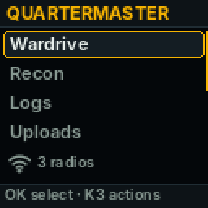 |  |

**A wardrive.** This wardrive is 26 minutes in and has a GPS fix. It has found 412 Wi-Fi networks and 187 Bluetooth devices, and written 1,677 rows to the log. The devices heard last are under the counts. **OK** asks whether to stop it, **K3** opens its actions, and **K2** goes back to the menu while it keeps running.

| Waveshare 1.44inch LCD HAT | Waveshare 1.3inch LCD HAT |
| --- | --- |
|  | 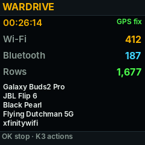 |

**The actions of a wardrive.** **K3** opens this list. **Filter: All** changes which devices the list shows. **Alerts** lists the alerts of this wardrive. **Pan details** shows the CardputerZero screen. Move to one and press **OK**, or press **K2** to close the list.

| Waveshare 1.44inch LCD HAT | Waveshare 1.3inch LCD HAT |
| --- | --- |
| 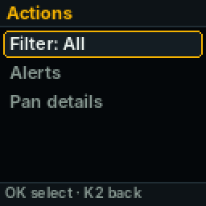 | 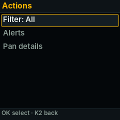 |

**Stopping, with Stop + save.** **OK** on a wardrive asks this question, with **Stop + save** chosen. It says what that choice does: the log is saved and sent to your upload sites. Press **OK** to do it, or **K2** to keep driving.

| Waveshare 1.44inch LCD HAT | Waveshare 1.3inch LCD HAT |
| --- | --- |
|  |  |

**Stopping, with Stop, don't save.** Move the joystick right on the stop question to get this red choice. The wardrive stops and is thrown away, but Quartermaster asks once more first.

| Waveshare 1.44inch LCD HAT | Waveshare 1.3inch LCD HAT |
| --- | --- |
|  |  |

**A drive alert.** A box at the bottom says what the wardrive found, here a Flock camera. Press **K3** and choose **Dismiss alert** to hide it, or **Quiet 10 min** to stop alert boxes and tones for 10 minutes.

| Waveshare 1.44inch LCD HAT | Waveshare 1.3inch LCD HAT |
| --- | --- |
|  |  |

**Hardware.** This screen shows one device at a time. Here it shows the GPS, which is card 4 of 5. It is a CP210x USB GPS on `/dev/ttyUSB0` with a fix. **HDOP 0.8** says how exact the fix is, and a lower number is better. Under it are the position and the number of satellites, 14. Move the joystick up or down for the other devices.

| Waveshare 1.44inch LCD HAT | Waveshare 1.3inch LCD HAT |
| --- | --- |
| 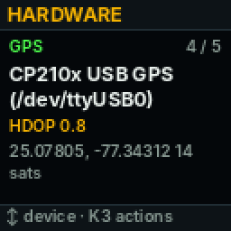 |  |

**Settings.** This screen shows one setting at a time. This is the first one, **Wi-Fi adapters**, set to **All**, in the section **SCANNING**. The line under it says what it does. Move up or down for the other settings. Move left or right, or press **OK**, to change it.

| Waveshare 1.44inch LCD HAT | Waveshare 1.3inch LCD HAT |
| --- | --- |
| 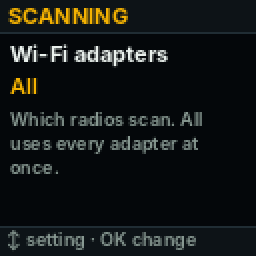 |  |

**Logs.** This screen lists your saved wardrives by date and time, newest first. The line under the list is the size of the one you are on, here 48 KB. **OK** opens it, and **K3** offers **Upload now**.

| Waveshare 1.44inch LCD HAT | Waveshare 1.3inch LCD HAT |
| --- | --- |
|  |  |

**Keys.** **Phone / PC setup** comes first. Under it are the keys of the three upload sites: **WiGLE API name**, **WiGLE API token**, **WDGWars API key** and **Wardrift API key**. Press **OK** on one to open it.

| Waveshare 1.44inch LCD HAT | Waveshare 1.3inch LCD HAT |
| --- | --- |
| 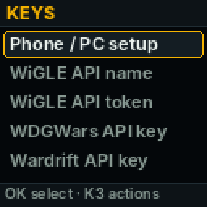 | 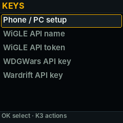 |

**Phone setup.** Scan the QR code with your phone, on the same network as the Pi, and paste your keys into the page that opens. The PIN under the code, here 482913, is new each time. **K3** offers **Address and PIN**, to open the page on a computer. **K2** closes the screen and the page. While the address and PIN show, the first **K2** goes back to the QR code, so press **K2** twice.

| Waveshare 1.44inch LCD HAT | Waveshare 1.3inch LCD HAT |
| --- | --- |
| 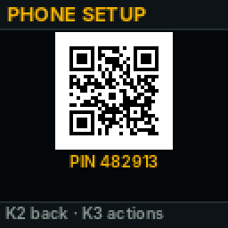 | 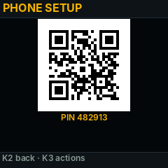 |

**Typing on the screen.** This is the text box of **WiGLE API name**, with the keyboard that **K3** opens. The key typed so far shows as dots. Move to a character, here **a**, and press **OK** to type it. **⌫** deletes a character, **✓** saves, and **K3** closes the keyboard.

| Waveshare 1.44inch LCD HAT | Waveshare 1.3inch LCD HAT |
| --- | --- |
| 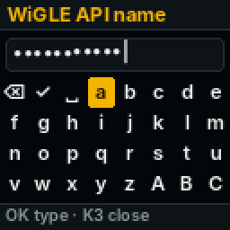 | 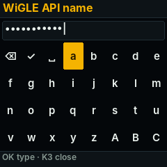 |

**Aircraft.** The list shows the aircraft heard, by callsign, and **QTM412** is chosen. The lines under the list say that it is 7,100 feet high at 262 knots, 8.0 km east of you, and was last heard 2 seconds ago. **OK** shows its details. **K3** offers **Save capture**, **Sort** and **Captures**.

| Waveshare 1.44inch LCD HAT | Waveshare 1.3inch LCD HAT |
| --- | --- |
| 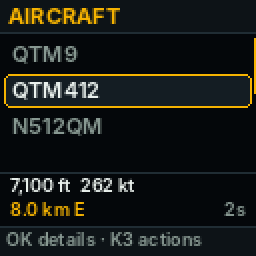 | 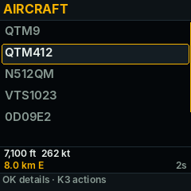 |

**One aircraft.** This screen shows the details of QTM412, one item per line: its ICAO code, callsign, squawk, category, heights and more. Move up or down to read it all, and press **OK** for its route.

| Waveshare 1.44inch LCD HAT | Waveshare 1.3inch LCD HAT |
| --- | --- |
| 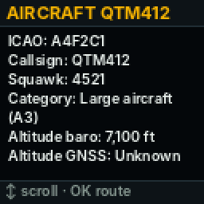 | 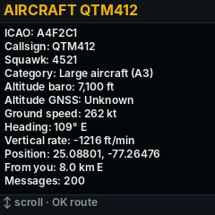 |

**The route of an aircraft.** This is the track of QTM412 on a small map. You are the cross in the middle, north is up, and the rings are 10 and 20 km from you. Move the joystick down for the positions heard, and press **K2** to go back.

| Waveshare 1.44inch LCD HAT | Waveshare 1.3inch LCD HAT |
| --- | --- |
| 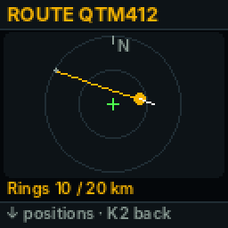 | 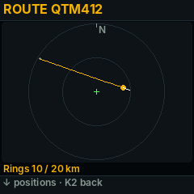 |

**Recon.** Recon is running and has flagged four devices: a Flock camera, an Axon body camera, a Ring camera and an AirTag. Recon has no small layout, so you see the left part of the CardputerZero screen. Press **K3** and choose **Pan details** to look across it.

| Waveshare 1.44inch LCD HAT | Waveshare 1.3inch LCD HAT |
| --- | --- |
| 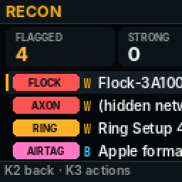 | 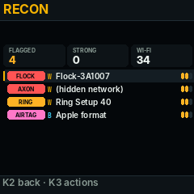 |

**About.** This screen shows the version, 1.2.12, and **Raspberry Pi DIY**, which tells you that this is the DIY version. On a CardputerZero, this screen says "for the CardputerZero" instead. **K3** offers **Tips**, with a few tips on the controls, wardrives, uploads and Recon.

| Waveshare 1.44inch LCD HAT | Waveshare 1.3inch LCD HAT |
| --- | --- |
|  |  |

## Using Quartermaster on the HAT

### Starting up

A ready image opens Quartermaster by itself each time the Pi starts. So does a manual install with the service switched on in step 5. A short animation of a ship plays first. Any button skips it. If you have not added any upload keys yet, a note says "Open Keys to add upload keys".

### The menu

The menu is a list of eight items: **Wardrive**, **Recon**, **Logs**, **Uploads**, **Hardware**, **Settings**, **Keys** and **About**. Move the joystick up or down to choose one, and press **OK** to open it.

The line under the list tells you about the item you are on. On **Wardrive**, it says how many radios will scan, or **BLE only** (Bluetooth only) when there is no Wi-Fi adapter or node. During a wardrive, it says **No fix yet** until the GPS has a fix, and then **REC** and the time. On **Hardware**, it says **GPS fix**, **GPS searching** or **No GPS**, or **Check adapter** when an adapter does not start. The small screens have no GPS mark at the top, so this is the quickest way to check the GPS.

**K2** on the menu asks "Quit Quartermaster?", with **Cancel** chosen. If you move to **Quit** and press **OK**, Quartermaster closes. It stays closed until the Pi starts again.

### Hardware

**Hardware** shows one device at a time: each Wi-Fi adapter with its bands, the RTL-SDR stick, the GPS, Bluetooth, and any problem. Its place in the list is in the top right corner, such as "4 / 5". Move the joystick up or down to go through them. To see more of them at once, press **K3** and choose **Pan details**. When no GPS is found, the GPS card says "Plug in a USB GPS or connect a receiver through gpsd."

### Your first wardrive

1. Open **Hardware** first. Check that your GPS has a fix and that your Wi-Fi adapters show the bands you expect. A GPS may need a clear view of the sky.
2. Go back to the menu with **K2**. Choose **Wardrive** and press **OK**. You can also press **K3** on the menu and choose **Start wardrive**.
3. Until the GPS has a fix, the screen says **Waiting for GPS fix**, with what the GPS is doing. Nothing is counted yet. The timer, the counts and the log start at the fix.
4. Then the screen shows the time since the start and **GPS fix** or **No fix**. Under them are three counts: **Wi-Fi** networks, **Bluetooth** devices and **Rows** written to the log. With an RTL-SDR stick or nodes, a line shows the number of aircraft and nodes. At the bottom are the devices heard last. When something is wrong, a warning shows there instead, such as "GPS fix lost. Logging pauses until it is back."
5. Move the joystick left or right to choose which devices the list shows: all of them, only Wi-Fi, or only Bluetooth. **Filter** in the **K3** list does the same.
6. **K2** goes back to the menu while the wardrive keeps running. On **Wardrive**, the menu then shows **No fix yet** until the GPS has a fix, and then **REC** and the time. Choose **Wardrive** again to come back to it.

### Stopping a wardrive

Press **OK** on the wardrive screen. The question "Stop the wardrive?" shows one choice at a time, and a line under the question says what stopping does. Move the joystick left or right to go through the choices, and press **OK** on the one you want.

- **Stop + save** is chosen first, so **OK** again stops the wardrive and saves it. The log is sent to your upload sites. If the GPS never had a fix, this choice is called **Stop**, because nothing was logged.
- **Stop, don't save**, in red, is one step to the right. Quartermaster asks once more, "Throw away this wardrive?", with **Cancel** chosen. Move right to **Throw away** and press **OK**. Nothing of that wardrive is kept or uploaded. If a part of a long wardrive was already uploaded, it stays on the upload site, and the question says so.
- **Cancel** is one step to the left of **Stop + save**. **K2** cancels too, and the wardrive goes on.

When the text is too long for the screen, move the joystick up or down to read all of it.

After **Stop + save**, a summary shows what the wardrive found. It shows the left part of the CardputerZero screen, so the numbers are cut off. Press **K3** and choose **Pan details**, then move the joystick right to read them. The **K3** list also offers **Logs**, **Uploads** and **New wardrive**. **OK** or **K2** goes back to the menu.

### Alerts while you drive

Drive Alerts are on from the start. When the wardrive hears a kind of device that you chose in **Settings > Alert me about**, such as a Flock camera, a box about it shows at the bottom of the screen. **Settings > Alert position** can put it at the top. While the box shows, the **K3** list offers:

- **Dismiss alert**, which hides the box.
- **Quiet 10 min**, which stops alert boxes and tones for 10 minutes. During the quiet time, the **K3** list of the wardrive screen offers **End quiet**.

On the wardrive screen, **Alerts** in the **K3** list shows every alert of this wardrive. The HATs have no speaker. Alert tones play on the Pi's sound output, if it has one. [Drive Alerts and Recon](guide/alerts.md) in the user guide explains alerts in full.

### Logs

**Logs** lists your saved wardrives by date and time, newest first. The line under the list shows the size of the one you are on, with **REC** for the log of a wardrive that runs now. **K3** offers **Upload now**. The marks that show which sites have each log are only on the CardputerZero layout: press **K3** and choose **Pan details**.

**OK** opens a log, with its file name, its size, its number of rows and what each upload site did with it. There, **K3** offers **Upload again** and **Delete**. To copy logs to your computer, use the phone setup page, which lists your 60 newest logs to download, or copy them over SSH as [Log in](#log-in) shows.

### Keys and the phone setup

Quartermaster sends finished logs to WiGLE, WDGWars and Wardrift once it has your key for a site. Open **Keys** on the menu.

- **Phone / PC setup** is the easiest way. Press **OK** on it. The screen shows a QR code with a PIN under it. Scan the code with your phone, which must be on the same network as the Pi, and paste your keys into the page that opens. The code holds the PIN, so the page opens straight away. On a computer, press **K3** and choose **Address and PIN**. Type the address into the browser, then the PIN. The screen says **Keys saved** once the page has saved them. **K2** closes the screen, and the page closes with it. While the address and PIN show, the first **K2** goes back to the QR code, so press **K2** twice.
- While the Pi is not on a network, the screen says "Connect the Pi and phone to the same network." After five wrong PINs, it says "Locked. Reopen setup." Close the screen with **K2** and open it again for a new PIN.
- To type a key on the Pi, move to it and press **OK**. Press **K3** for the keyboard on the screen, or type on a USB keyboard. What you type shows as dots. On a key, **K3** offers **Test** and **Remove**.

The Keys list does not show which keys are saved. The menu line under **Keys** says how many of the 3 sites have one, such as **1 of 3 set**. To see more, press **K3** and choose **Pan details**.

### Uploads

Finished logs go to your upload sites by themselves whenever the Pi is online, unless **Settings > Send logs** is set to **Only when asked**. The **Uploads** screen shows the CardputerZero layout, with what was sent, what is waiting and what was refused for each site. **OK** uploads now. **K3** offers **Test keys** and **Keys**.

The Pi uses the Wi-Fi network you gave Raspberry Pi Imager. To join another one, such as the hotspot of your phone, log in and run `sudo nmtui`. A Zero W, Zero 2 W or 3B can only join a 2.4 GHz network.

### Settings

**Settings** shows one setting at a time. At the top is its section, such as **SCANNING**. Under it are the setting, its value and a line about what it does. Move the joystick up or down to go from setting to setting. Move it left or right to step through the values, or press **OK**. When a setting has more than two values, **OK** opens a list of them. During a wardrive, the settings for scanning, Deep scan, logging and the GPS cannot be changed, and the line says "Stop the wardrive to change this."

Some settings that are good to know on a Pi:

- **Start wardrive on launch** makes Quartermaster start a wardrive by itself each time the Pi starts.
- **Country** sets the Wi-Fi channels that nodes use and that Deep scan listens on. It does not change the Pi's own Wi-Fi country. See **Wi-Fi country** under [Good to know](#good-to-know).
- **Check for updates**, at the end, asks GitHub for a newer Pi release. **OK** checks again. Nothing is downloaded.
- The lists, such as **Ignored networks**, **Alert me about** and **My alerts**, show the CardputerZero layout. Their letter keys are in the **K3** list.

[Settings](guide/settings.md) in the user guide explains every setting.

### The aircraft viewer

The aircraft viewer is new in 1.2.9. With an RTL-SDR stick, it shows the aircraft around you.

1. Plug the stick into the Pi. On a Zero, plug it into the OTG hub.
2. Open **Hardware** and move to the card **Radio for aircraft (RTL-SDR)**. When the stick is ready, the card shows **K3: Aircraft**. When it cannot listen, the card says why.
3. Press **K3** and choose **Aircraft**.

The list shows the aircraft heard, nearest first, by callsign or by ICAO code. Under the list are the height and speed of the aircraft you are on, how far away it is and in which direction, and how long ago it was last heard. Move up or down to choose an aircraft.

- **OK** shows the details of that aircraft, one item per line. Move up or down to read it all.
- **OK** again shows its route on a small map. You are the cross in the middle, north is up, and the rings show the distance. Move down for the positions heard, newest first, and up again for the map.
- **K3** on the list offers **Save capture** (or **End capture** while one runs), **Sort**, which switches between nearest first and latest first, and **Captures**, the captures you saved. A capture is kept in `~/quartermaster/aircraft`. In **Captures**, **K3** offers **Delete**.
- **K2** goes back one step. Leaving the list closes the viewer, and a capture that still runs is saved.

During a wardrive that listens for aircraft, the viewer shows what the wardrive hears. [Aircraft and LoRa mesh](guide/aircraft-and-lora.md) in the user guide has more.

### Recon

Recon looks for cameras, trackers and other surveillance gear around you, and warns you. It never runs together with a wardrive.

1. On the menu, choose **Recon** and press **OK**.
2. Press **K3** and choose **Start**. Before you start, the **K3** list also offers **Watch list**, the kinds of device Recon looks for.
3. The list shows the devices Recon flagged, each with its kind, such as **FLOCK** or **AIRTAG**. Move up or down to choose one, and press **OK** for its details. Press **OK** again for the signal finder, which helps you walk towards the device.
4. While Recon runs, the **K3** list offers **Stop**, **All** to list every device heard (then **Flagged** to go back), and the sort, such as **Threat**. Choosing the sort moves to the next one.

Recon has no small layout. The screen shows the left part of the CardputerZero screen, so press **K3** and choose **Pan details** to look across it. **K2** goes back to the menu, and Recon keeps running. If you start a wardrive while Recon runs, Quartermaster asks first, and Recon stops.

### Switching off

Stop the wardrive before you switch the Pi off, so that its log is saved and sent. If the power goes during a wardrive, Quartermaster finishes that log the next time it starts. To shut the Pi down, log in and type `sudo poweroff`.

## How the DIY version differs from the CardputerZero

Both versions are Quartermaster, made from the same code, with the same screens and nearly the same settings. They run on different devices and are installed in different ways. Their version numbers can differ.

| | CardputerZero version | DIY version |
| --- | --- | --- |
| Device | The M5Stack CardputerZero, with its 320×170 screen and its keyboard | A Raspberry Pi Zero W or WH, Zero 2 W or WH, 3B, 3B+ or 4B, with a Waveshare 1.44inch LCD HAT (128×128) or a Waveshare 1.3inch LCD HAT (240×240) |
| Controls | The keys of the Cardputer | The joystick, **K1**, **K2** and **K3**, or a USB keyboard |
| How to install | From the CardputerZero AppStore (share code **WARD**), or with the one command in the [README](../README.md) | With a ready SD card image for your HAT, or with the Pi package on Raspberry Pi OS |
| Package | `quartermaster`, downloaded as `quartermaster.deb` | `quartermaster-pi`, downloaded as `quartermaster-pi_1.2.12_all.deb` |
| Releases on GitHub | Their tags start with `v`. The newest one has GitHub's **Latest** badge. | Their tags start with `pi-v`, such as [pi-v1.2.12](https://github.com/valleytechsolutions/Quartermaster/releases/tag/pi-v1.2.12), and their names end in "for Raspberry Pi". They never have the **Latest** badge. A new Pi release is marked **Pre-release** until it has been tested. |
| Updates | From the AppStore | From the newest Pi release: its package or its image |
| GPS | A USB GPS, the Cap LoRa-1262, a Grove GPS or gpsd | A USB GPS or gpsd |
| LoRa mesh and LoRaWAN | With the Cap LoRa-1262 | None |
| Battery | Built in | Only with a power supply that reports a battery to Linux |
| Starts | From the launcher | By itself when the Pi starts. After a manual install, only with the service switched on. |
| Files | In the `quartermaster` folder of your home folder | On a ready image, in `/var/lib/quartermaster/quartermaster`. After a manual install, in your home folder. |
| The **About** screen says | "for the CardputerZero" | "Raspberry Pi DIY" |

The two packages cannot be installed together.

**Radios and GPS.** The DIY version scans with the Pi's built-in Wi-Fi and Bluetooth, USB Wi-Fi adapters and Quartermaster nodes, and listens for aircraft with an RTL-SDR stick. The GPS is a USB GPS, or a receiver that runs through `gpsd`. With **Settings > GPS source** on **Auto**, Quartermaster finds either one by itself. The Cap LoRa-1262 and the Grove port are parts of the CardputerZero. So the DIY version has no LoRa mesh (Meshtastic and MeshCore), no LoRaWAN alerts and no Cap or Grove GPS. Settings has no **LoRa mesh** and no **Cap and Grove power**, and **GPS source** has no **Cap / Grove** choice.

**Sound.** The HATs have no speaker. Alert tones play on the Pi's sound output, if it has one.

**Battery.** A Pi has no battery of its own. The battery level shows at the top of the screen only when the Pi's power supply reports a battery to Linux. Only then does Quartermaster save a running wardrive at 5 % and close at 3 %, as it does on the CardputerZero. Without one, there are no battery warnings, so use a power supply or a USB battery that gives enough current for the Pi and everything plugged into it.

**Updates.** There is no AppStore on a Pi. **Settings > Check for updates** asks GitHub for the newest Pi release, and says when there is a newer one. Nothing is downloaded. To update, install the `quartermaster-pi` package of the newest Pi release, or flash its newest image. **Updating** and **Flashing the newest image** under [Good to know](#good-to-know) show both ways, and what to copy before you flash. The Pi releases are on the [releases page](https://github.com/valleytechsolutions/Quartermaster/releases). Never run the one command of the README on a Pi, because it always fetches the CardputerZero package from the release with the **Latest** badge.

**Where the files are.** After a manual install, Quartermaster runs under your own login, and its files are in your home folder, as on the CardputerZero. A ready image runs it under its own account, `_quartermaster`, so its files are here:

| What | Where on a ready image |
| --- | --- |
| Logs, Recon and Drive Alert files, aircraft captures, `uploads.json` and `errors.log` | `/var/lib/quartermaster/quartermaster` |
| Your settings and upload keys | `/var/lib/quartermaster/.config/quartermaster` |

Your login has a link called `quartermaster` in its home folder, so `~/quartermaster/logs` holds your logs. [Log in](#log-in) shows how to copy them to your computer.

**The display setting.** The CardputerZero has one screen. The DIY version has to know which HAT it drives. The file `/etc/quartermaster/display` holds `st7735-128` for the 1.44inch HAT, which is the default, or `st7789-240` for the 1.3inch HAT. On a ready image, `quartermaster.txt` on the card's **bootfs** drive sets it at every start, so change it there.

**The service.** A ready image starts Quartermaster with the service `quartermaster@_quartermaster.service`. After a manual install, the service is `quartermaster@<your user>.service`, which you switch on in step 5. When Quartermaster stops because of an error, the service starts it again after a few seconds. After **Quit**, it stays closed until the Pi starts again.

**The screen.** The CardputerZero's screen is wide. The HATs are small and square, so the screens you use most have their own small layout, and the others show the CardputerZero screen with **Pan details**. See [Controls](#controls).

## Troubleshooting

**The screen stays blank.**

- The first start of a new card takes a few minutes, and the Pi may restart once. Wait for it.
- Switch the Pi off and check that the HAT sits fully on the 40-pin header, with pin 1 lined up.
- If you chose **Quit** on the menu, Quartermaster stays closed until the Pi starts again. Restart the Pi.
- After a manual install, check that you ran every command of steps 3 to 5 and restarted the Pi.
- If it is still blank, log in and read the app's log: `sudo journalctl -b -u quartermaster@_quartermaster.service` on a ready image, or `journalctl -b -u "quartermaster@$USER.service"` after a manual install. A line such as "Cannot open st7735-128 display or controls" says what went wrong. [Checking a build](#checking-a-build) has more checks.

**The picture is wrong.** When the text is not readable, the colors are wrong or an edge of the menu is missing, the display setting may not match your HAT. On a ready image, change the last line of `quartermaster.txt`, as **Wrong HAT?** under [Good to know](#good-to-know) shows. You can also log in, edit it with `sudo nano /boot/firmware/quartermaster.txt` and restart the Pi. After a manual install, write the right setting into `/etc/quartermaster/display` as step 4 shows, and restart the Pi.

**The Pi never shows up on the network.**

- Wait until the menu shows on the HAT. The first start takes a few minutes.
- The Pi needs a network: the Wi-Fi you gave Imager, or an Ethernet cable on a 3B, 3B+ or 4B.
- If `quartermaster.local` is not found, look for the Pi in your router's list of devices. Then type `ssh pi@<address>`, with the Pi's address in place of `<address>`, for example `ssh pi@192.168.1.23`. A hostname set in Imager replaces `quartermaster`.
- A Zero W, Zero 2 W or 3B can only join a 2.4 GHz network. If your router has a separate 5 GHz name, the Pi needs the 2.4 GHz name. On a new card, write the card again and give Imager that name. Writing erases the card, so if you have already saved drives on it, join the network from the Pi instead, as the next point shows.
- To join a network from the Pi, log in and type `sudo nmtui`. To log in without Wi-Fi, use an Ethernet cable on a 3B, 3B+ or 4B, or plug a screen and a keyboard into the Pi. Quartermaster may react to that keyboard too, so quit it first: press **K2** on the menu, move to **Quit** and press **OK**. It starts again when the Pi restarts. A card written with **Use custom** or balenaEtcher has no Wi-Fi network on it, so it needs this too.

**Your computer refuses to connect after you flashed the card again.** The Pi made new SSH keys. Run `ssh-keygen -R quartermaster.local` on your computer once, then connect again. If you connect with another name or with the Pi's address, type that in place of `quartermaster.local`, for example `ssh-keygen -R 192.168.1.23`.

**The password.**

- The default login is user `pi` with password `pi`. Nothing shows on the screen while you type a password.
- A username and password set in Raspberry Pi Imager replace it, and then `pi` no longer works. Log in with your own.
- At each login, the Pi says when `pi` still has the default password. Type `passwd` to change it.
- If you forgot your new password, write the card again. Writing erases the card. First download your saved drives from the phone setup page under **Keys**. The page lists your 60 newest drives, and it needs only the PIN on the screen, not the password. Without the password, you cannot copy the `recon` and `aircraft` folders over SSH.

**No GPS fix.** Open **Hardware** and move to the GPS card.

- "No GPS found": plug the GPS into the Pi. On a Zero, use the port marked **USB**. The port marked **PWR IN** is only for power. To plug in a GPS and a Wi-Fi adapter together, use an OTG hub. Check that **Settings > GPS source** is on **Auto**.
- "Waiting for it to send a position": the GPS is plugged in but has sent no position yet. Wait a minute. If it never sends one, it may not send standard NMEA data.
- "No fix yet. It needs a view of the sky.": take it outside, with a clear view of the sky, and wait.
- A wardrive logs nothing without a fix. It says **Waiting for GPS fix** until the first one, and pauses when the fix is lost. When it says "GPS fix is too weak", **Settings > GPS accuracy needed** sets how exact the fix must be.

**Wi-Fi misses networks, channels or 6 GHz.** Set the Pi's own Wi-Fi country. Until you do, Wi-Fi keeps to the channels that are allowed everywhere, and each login reminds you. Log in and run `sudo raspi-config nonint do_wifi_country US`, with your own two-letter country code in place of `US`. **Settings > Country** in Quartermaster is a different setting: it does not change the Pi's Wi-Fi country.

**Quartermaster closed.** After **Quit** on the menu, Quartermaster stays closed until the Pi starts again. Restart the Pi with `sudo reboot`, or on a ready image start it with `sudo systemctl start quartermaster@_quartermaster.service`. When Quartermaster stops because of an error, it starts again by itself after a few seconds.

**Power problems.** When the power supply is too weak, the Pi reports under-voltage. During a wardrive, the Hardware screen then shows "USB power ran short", with the reason "The Pi reports under-voltage". Use a stronger power supply, and a powered USB hub for the adapters. See [Power and USB hubs](guide/power.md#on-a-diy-raspberry-pi).

**Raspyjack on the same card.** Only one app at a time can use the screen and the buttons. Stop Raspyjack's display service before you start Quartermaster.

**Messages that ask you to restart, update or reinstall.** Where a message says to restart the Pi, such as "Restart the Pi once so the new permission applies.", log in and type `sudo reboot`. Where a message says "Update Quartermaster", "Reinstall Quartermaster" or "Radio helper not found. Reinstall the Pi package from GitHub.", follow [On a DIY Raspberry Pi](guide/troubleshooting.md#on-a-diy-raspberry-pi) on the troubleshooting page of the user guide.

[Troubleshooting](guide/troubleshooting.md) in the user guide explains every message of the Hardware screen.

## Checking a build

- `quartermaster --version` prints the version of Quartermaster. On a ready image, `cat /etc/quartermaster/image-release` also shows the HAT the image was made for and the day it was built.
- `quartermaster --probe` lists the display setting, the Wi-Fi adapters and the GPS ports that Quartermaster can see. It shows the setting, not the HAT on the Pi. To check the screen itself, look for readable text, the right colors, and all four edges of the menu.
- If the screen stays blank, check the setting in `/etc/quartermaster/display`, check that `/dev/spidev0.0` exists, and read `journalctl -b -u "quartermaster@$USER.service"`. On a ready image, the service is `quartermaster@_quartermaster.service`, and `quartermaster.txt` on the boot partition sets the display at every start. Both HATs use SPI0 CE0. The backlight, the display and the joystick need access to the Pi's GPIO.
- A full check of a new build tries every joystick direction, the joystick press, **K1**, **K2** and **K3**, a GPS fix, a saved drive, and a restart back to the menu. Quartermaster's tests draw the screens and press the buttons in software for both HATs. How the screen is turned, how well the radios hear and how long a battery lasts can only be checked on a real build.
