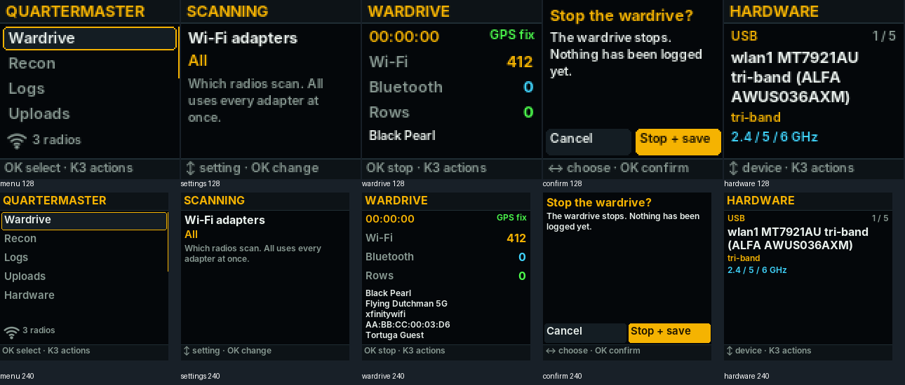

# Build a DIY Quartermaster

Use a Raspberry Pi, either of Raspyjack's joystick HATs, and a GPS to build a handheld Quartermaster. The package installs on Raspberry Pi OS. Keep your current SD card if you already use Raspyjack and want to switch between the two systems.

## Parts

| Part | What to use |
| --- | --- |
| Computer | Raspberry Pi Zero 2 WH, or Zero 2 W with a soldered 40-pin header. Pi 3B, 3B+ and 4B also have the header. The original Zero W/WH requires 32-bit Raspberry Pi OS and has a slower single-core CPU. |
| Display | Pick one of the HATs below. Both plug directly onto the 40-pin header and include the controls. |
| Storage and power | A microSD card for Raspberry Pi OS Lite and logs, and a power supply or USB battery sized for the Pi and its peripherals. |
| Position | A USB GPS that outputs NMEA, or a receiver available through local `gpsd`. Quartermaster waits for a valid fix and clock before it writes WiGLE rows. |
| Optional radios | A supported USB Wi-Fi adapter for additional bands, USB Quartermaster nodes, or an RTL-SDR for aircraft. A Zero has one USB OTG data port. Use an OTG hub when connecting multiple USB peripherals and provide enough power for the radios. |

| Waveshare LCD HAT | Controller | Profile |
| --- | --- | --- |
| [1.44″ joystick HAT, 128×128](https://www.waveshare.com/1.44inch-lcd-hat.htm) | ST7735S | `st7735-128` |
| [1.3″ IPS joystick HAT, 240×240](https://www.waveshare.com/wiki/1.3inch_LCD_HAT) | ST7789 | `st7789-240` |

The Zero 2 W's onboard Wi-Fi covers 2.4 GHz. A 3B+ or 4B adds onboard 5 GHz. For 6 GHz, add a Linux-supported tri-band adapter and check the bands shown under **Hardware**. The Cardputer's Cap LoRa-1262, Grove port and power rails are specific to the M5Stack hardware. Use USB GPS or gpsd on a Pi. Battery percentage requires a power supply that reports a system battery to Linux. [Pi Zero specifications](https://www.raspberrypi.com/products/raspberry-pi-zero-2-w/) · [Quartermaster adapter list](https://github.com/valleytechsolutions/Quartermaster#wi-fi-adapters)

## Assemble and install

1. With the Pi powered off, align pin 1 and seat the HAT on the GPIO header. Plug in the GPS. On a Zero use the micro-USB port marked **USB** for data and **PWR IN** for power.
2. For a new build, write Raspberry Pi OS Lite (Trixie) to the microSD. Zero 2 W, 3B, 3B+ and 4B can use 32-bit or 64-bit. The original Zero W needs 32-bit. RaspyJack's DIY guide uses the 32-bit edition. In Raspberry Pi Imager configure a username, network and SSH. If your existing build runs Raspberry Pi OS Bookworm with the standard Raspberry Pi repositories, you can install on that card starting at step 3.
3. Boot the Pi and connect over SSH. Download the installer and checksum from the [Quartermaster Pi 1.2.5 release](https://github.com/valleytechsolutions/Quartermaster/releases/tag/pi-v1.2.5). Run these commands in a new directory on the Pi.

```sh
release=https://github.com/valleytechsolutions/Quartermaster/releases/download/pi-v1.2.5
wget "$release/quartermaster-pi_1.2.5_all.deb" "$release/SHA256SUMS"
sudo apt update
sudo raspi-config nonint do_spi 0
sha256sum --check SHA256SUMS && sudo apt install ./quartermaster-pi_1.2.5_all.deb
```

Check that the checksum command reports `OK` before installing. To build the same version from source, check out `pi-v1.2.5` and run `python3 tools/build_deb.py --target pi` on Raspberry Pi OS or Debian Trixie. The Pi package is written to `build/`. Use that path for the install command.

4. The installed display setting defaults to the 1.44″ HAT. For the **1.3″ HAT**, select its profile before rebooting.

```sh
echo st7789-240 | sudo tee /etc/quartermaster/display
```

5. For a self-contained handheld, enable the display service for your login user and reboot. The reboot also applies SPI and device group permissions.

```sh
sudo systemctl enable "quartermaster@$USER.service"
sudo reboot
```

The Pi now opens Quartermaster on the HAT. To launch it manually instead, leave the service disabled, reboot once, and run `quartermaster` as your normal user. Setup does not require the Raspyjack software. If using the same OS installation for both apps, stop the other display service before starting Quartermaster so only one app owns the SPI screen and buttons.

## First drive

The top row shows the 128×128 display and the bottom row shows the 240×240 display. These previews use sample observations.



1. Move the joystick through the menu. Click the stick or press **K1** to select. **K2** goes back. **K3** opens the actions for the current screen. It opens an on-screen keyboard inside a text field.
2. Open **Hardware**. Check that your GPS has a fix and that the expected Wi-Fi adapters and bands appear. A GPS may need a clear view of the sky.
3. Choose **Wardrive**. The square dashboard shows GPS and radio counts. Press **OK**, choose **Stop + save**, and confirm. Open **Logs** to see the saved drive. Logs live under `~/quartermaster/logs/` for the user running the app.
4. Open **Keys** for phone setup or use a USB keyboard for longer text. On detailed screens, choose **K3 → Pan details** and move the stick to read across the original layout. Press **K2** to return to normal navigation.

## Checking a build

- `quartermaster --probe` reports the selected profile and detected adapters and GPS ports. The profile is the configured choice. To verify the panel, look for readable text, correct colors, and all four edges of the menu.
- If the screen stays blank, check the profile in `/etc/quartermaster/display`, verify `/dev/spidev0.0` exists, and read `journalctl -b -u "quartermaster@$USER.service"`. Both HATs use SPI0 CE0. The backlight, display and joystick need access to the Pi's GPIO.
- A physical acceptance check for each HAT includes every joystick direction, the center press, K1–K3, a GPS fix, a saved drive and a reboot back to the menu. Frame rendering and simulated I/O tests cover both profiles. Panel orientation, radio reception and runtime on battery require an assembled unit.
