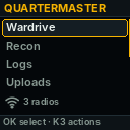
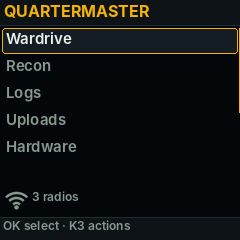

# Quartermaster user guide

This guide explains how to use Quartermaster 1.2.11 on the M5Stack CardputerZero. It is written for everyone, not only for people who know Linux or radio.

The AppStore and the one command can give you an older version than 1.2.11. Then some things in this guide are not on your Cardputer yet, such as **Power guard**, **Stop, don't save** and the aircraft viewer. The **About** screen shows which version you have, and the [changelog](../../CHANGELOG.md) says what each version brought.

There is also a DIY version of Quartermaster, for a Raspberry Pi with a Waveshare LCD HAT. It has the same screens and nearly the same settings, with other controls. This guide is written for the CardputerZero. Where the DIY version works differently, the page ends with a section called **On a DIY Raspberry Pi**. The [DIY guide](../diy.md) explains how to build and install the DIY version, its controls and what is different. To tell the two versions apart, see [The CardputerZero version and the DIY version](#the-cardputerzero-version-and-the-diy-version) below.

A few words used everywhere in this guide:

- **Wardrive:** a drive (or walk) where Quartermaster records the Wi-Fi networks and Bluetooth devices it hears, with their GPS positions.
- **Adapter:** a Wi-Fi radio. The Cardputer has one built in. You can plug in more on USB.
- **Log:** the file a wardrive makes. Upload sites such as WiGLE read it.
- **GPS fix:** the moment your GPS knows where you are. Nothing is logged without one.

## Start here

1. [Install and update](install.md)
2. [First start and the GPS](first-start.md)
3. [The wardrive screen and keys](wardrive.md)

## Everything else

- [Settings](settings.md): every setting, what it does and its default.
- [Wi-Fi adapters](wifi-adapters.md): which ones work, 6 GHz, "driver CD" adapters and firmware.
- [Power and USB hubs](power.md): how much power radios need, signs of trouble, Power guard.
- [Getting the most networks](more-networks.md): what helps, what does not, and how to compare two drives.
- [Deep scan and the radio helper](deep-scan.md)
- [Drive Alerts and Recon](alerts.md): warnings about cameras, trackers and more.
- [Nodes](nodes.md): extra ESP32-C5 scanners, plugged in or wireless.
- [Biscuit node](biscuit.md): scan 6 GHz for a Biscuit or Biscuit Pro.
- [Aircraft and LoRa mesh](aircraft-and-lora.md): ADS-B, Meshtastic, MeshCore and LoRaWAN.
- [Uploads](uploads.md): WiGLE, WDGWars and Wardrift keys, and the phone setup page.
- [Files and logs](files.md): where everything is kept.
- [Troubleshooting](troubleshooting.md): every Hardware screen message, and common problems.
- [Build a DIY Quartermaster](../diy.md): a Raspberry Pi with a Waveshare joystick screen, the same parts as Raspyjack.
- [License and credits](license.md)

## The CardputerZero version and the DIY version

Both versions are Quartermaster, made from the same code. They run on different devices and are installed in different ways, so keep them apart.

| | CardputerZero version | DIY version |
| --- | --- | --- |
| Device | The M5Stack CardputerZero, with its 320×170 screen and its keyboard | A Raspberry Pi Zero W or WH, Zero 2 W or WH, 3B, 3B+ or 4B, with a Waveshare 1.44inch LCD HAT (128×128) or a Waveshare 1.3inch LCD HAT (240×240) |
| Controls | The keys of the Cardputer | The joystick and the buttons **K1**, **K2** and **K3** on the HAT, or a USB keyboard |
| How to install | From the CardputerZero AppStore (share code **WARD**), or with the one command in [Install and update](install.md) | With a ready SD card image for your HAT, or with the Pi package. See [Install and update](install.md#on-a-diy-raspberry-pi). |
| Package | `quartermaster`, downloaded as `quartermaster.deb` | `quartermaster-pi`, downloaded as `quartermaster-pi_1.2.11_all.deb` |
| Releases on GitHub | Their tags start with `v`. The newest one has GitHub's **Latest** badge. | Their tags start with `pi-v`, such as [pi-v1.2.11](https://github.com/valleytechsolutions/Quartermaster/releases/tag/pi-v1.2.11), and their names end in "for Raspberry Pi". They never have the **Latest** badge. |
| Cap LoRa-1262 (Meshtastic, MeshCore and LoRaWAN) and a Grove GPS | Yes | No |
| The **About** screen says | "for the CardputerZero" | "Raspberry Pi DIY" |

On the Pi, you move with the joystick. Press the joystick or **K1** for **OK**. **K2** goes back, like **Esc**. **K3** opens a list of the actions of the screen you are on, which the CardputerZero has on letter keys. [The wardrive screen and keys](wardrive.md#on-a-diy-raspberry-pi) lists every key of the Pi.

Where a page says "the Cardputer", the same goes for your Pi, unless the page's section **On a DIY Raspberry Pi** says otherwise.

This is the DIY menu on both HATs. The 1.44inch HAT is drawn at twice its size.

| Waveshare 1.44inch LCD HAT | Waveshare 1.3inch LCD HAT |
| --- | --- |
|  |  |

## Good to know

- Quartermaster only listens and scans. It never joins a network and never pairs with a Bluetooth device.
- Record only what is legal where you are, and follow the rules of the sites you upload to.
- Every screen shows its own keys along the bottom. When in doubt, look there.
