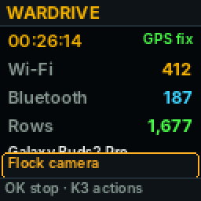
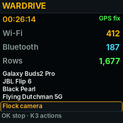
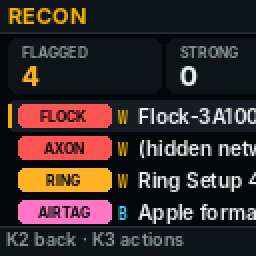
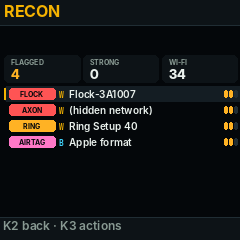

# Drive Alerts and Recon

[Back to the guide](README.md)

Quartermaster can warn you about cameras, trackers and other gear it hears. There are two ways:

- **Drive Alerts** run during a normal wardrive, from what the wardrive already hears. They use no radio of their own and never change your logs. The one exception is LoRaWAN: when **LoRaWAN networks** is on, the Cap LoRa-1262 adds a 30-second LoRaWAN turn to its listening, which leaves a little less time for Meshtastic and MeshCore.
- **Recon** is a separate mode (**R** on the menu) that only looks for such devices, with a list and a signal finder. Recon and a wardrive never run together.

A match is broadcast evidence. It is not proof that a device is recording, who owns it, or what it is for. Many products share radio parts, so weak hints are common.

## The 20 kinds of device

These are SquachWatch's detection types, with its names and in its order.

| Kind | What it covers | Drive Alerts default | In Recon |
| --- | --- | --- | --- |
| Flock cameras | Flock cameras, batteries and accessories | On | On |
| Axon body cams | Axon, WatchGuard and Digital Ally body cameras. Some in-car routers too, as weak hints | On | On |
| Meta glasses | Ray-Ban Meta, Oakley Meta, Snap Spectacles and other camera glasses | On | On |
| Card skimmers | Serial Bluetooth modules found in card skimmers | Off | On |
| Raven sensors | Raven gunshot sensors | Off | On |
| AirTags | AirTags and other Find My accessories | Off | On |
| Drones | Remote ID broadcasts and drone makers | Off | On |
| ALPR cameras | Licence plate readers other than Flock | Off | On |
| Cameras | Security cameras, dashcams and hidden camera hotspots | Off | On |
| Samsung tags | Samsung SmartTag | Off | On |
| Google tags | Find Hub trackers such as Chipolo, Pebblebee and Moto Tag | Off | On |
| Tile trackers | Tile | Off | On |
| Ring cameras | Ring doorbells and cameras | Off | On |
| Deauth floods | Bursts of Wi-Fi disconnect messages | Off | Wardrive only |
| Evil twin APs | One network name open on one access point and protected on another | Off | Wardrive only |
| Proximity beacons | iBeacons | Off | Off |
| Hacker hardware | Flipper Zero, Pwnagotchi, WiFi Pineapple, deauthers and the like, and bursts of fake Bluetooth adverts | Off | On |
| LoRaWAN networks | The operator of a LoRaWAN network in range, with the Cap LoRa-1262 | Off | Wardrive only |
| My alerts | Your own names and addresses | On | Wardrive only |
| Smart speakers | Sonos, HomePod, and Echo or Google speakers in setup | Off | Off |

## Drive Alerts

Turn them on or off with **Settings > Alerts while wardriving** (on by default).

### Choosing kinds and tones

Open **Settings > Alert me about**:

| Key | What it does |
| --- | --- |
| **OK** | Turn alerts for this kind on or off |
| **Z** / **C** | Pick a tone. It plays as you pick |
| **P** | Play the tone again |
| **T** | Turn the tone of this kind off (the alert still shows) |
| **D** | Restore the defaults |

The tones are **Siren, Yelp, Chirp, Shutter, Ping, Blip** and **Silent**. By default Axon body cams use Siren, Flock cameras Chirp, Meta glasses Ping, and every other kind Blip.

- **Settings > Alert tones** turns every tone off. Alerts still show on screen.
- **Settings > Tone volume**: Loud, Medium (default) or Quiet. It also sets the Recon beep.
- If no speaker is found, a note says "No speaker found: alerts show on screen only".

### The banner

An alert shows as a card at the bottom of the screen, above the key hints, for 6 seconds (10 for a body camera). **Settings > Alert position** can put it at the **Top** instead. It never covers the counters, and **OK** still stops the wardrive.

- More of the same kind add to the card (for example ×3) instead of replacing it.
- A more urgent kind takes its place at once. Several waiting together show as one card, such as "3 new alerts".
- **A** on the wardrive screen lists the alerts of the drive, newest first. It keeps the newest 100. Older ones leave the list but stay in the drive's file in `recon/` (see [Files and logs](files.md)). **OK** on one shows its details: kind, evidence, name, address, signal, when and where.

### Dismiss, quiet and silence

| Key | Where | What it does |
| --- | --- | --- |
| **Del** | While a banner shows | Hides it now. It stays in the alert list. |
| **Q** | Wardrive screen, alert list, or while a banner shows | No tones and no banners for 10 minutes. The wardrive screen shows the time left, such as **Q 9m**. Alerts are still listed and logged. **Q** again ends it. |
| **N** | On an alert's details screen (press **OK** on the alert in the list first) | No more alerts for that device. It is still logged and uploaded. **N** does nothing on the list itself, and it is not offered for floods (such as "30 flock cameras in 1 min"), deauth floods or bursts of fake adverts. |

After **N**, the device's address is kept in **Settings > No alerts for** (up to 32). If its Bluetooth address keeps changing, its name is kept instead, and anything with that name stops alerting. A device with a changing address and no name, like most Meta glasses, is silenced for this drive only. Remove an entry with **D** in that list.

### Not too many alerts

- A device alerts once while it is around. Flock and other fixed cameras alert once per drive. Moving devices, such as body cameras, may alert again after they have been gone for 15 minutes (**Settings > Alert again (moving devices)**).
- Weak hints are saved but do not alert (**Settings > Alert from**). Weak signals below **Settings > Only when signal is above** are saved but do not alert.
- No tones in the first minute of a wardrive. Those alerts still show.
- A Flock tone plays at most once a minute, a My alert every 30 seconds, Meta glasses every 2 minutes, body cameras and other kinds every 5 minutes. In a busy town a kind sounds less often.
- A flood of new devices of one kind mutes that kind for 5 minutes. Flock cameras, body cameras, Meta glasses and My alerts are never muted.

### My alerts

**Settings > My alerts** holds up to 8 Wi-Fi or Bluetooth names, patterns or addresses (MAC addresses) that always alert, whatever kind of device they are. Each entry can be up to 32 characters. Press **A** to add, **D** to remove.

- A plain name matches every name that starts with it: `veh` matches every name that starts with veh.
- `*` matches any text and `?` matches any one character.
- Capitals do not matter.

### Dragon Detector

Plug a Dragon Detector into USB and its alerts join in. Quartermaster says "Dragon Detector found. Its alerts join wardrive alerts."

## Recon

Press **R** on the menu. The first screen shows your radios, how many kinds it watches, the GPS and where flagged devices are logged.

| Key | What it does |
| --- | --- |
| **Space** | Start or stop Recon |
| **T** (before starting) | Watch list: **OK** turns a kind on or off, **A** turns all on |
| **A** | Show only flagged devices, or all devices heard |
| **S** | Sort by threat, signal or most recent |
| **OK** | Details of a device |
| **OK** again (in details) | The signal finder: a big meter to walk toward the device. **R** resets the peak |
| **Esc** | Back to the menu. Recon keeps running |

Each match is graded as a **Weak indicator**, **Medium evidence** or **Strong signature**, and the details show what matched. A device heard at several places you have been, over ten minutes or more, is marked **FOLLOWING**.

On other screens, a Recon alert shows as a card at the bottom (or top), like Drive Alerts. **Del** hides it. A device that stays nearby alerts once, and again only after it has been gone for 15 minutes, or when it starts to follow you. **Settings > Alert sound** turns the Recon beep on or off.

Recon hears Wi-Fi and Bluetooth only (plus nodes and Deep scan), so its watch list leaves out deauth floods, evil twins, LoRaWAN networks and My alerts.

## What cannot be detected

- **Flock cameras** often show no network or Bluetooth signal of their own. Without [Deep scan](deep-scan.md) (or a Dragon Detector) they are only found when they do. Deep scan hears their probe requests.
- **Meta glasses** and other Bluetooth devices are only seen while they send Bluetooth adverts. A device that is not advertising as you pass is missed.
- **Silent devices** that send nothing while you pass cannot be seen at all. A camera recording to a memory card, with its radio off, is invisible.
- **LoRaWAN** is heard on one channel and one data rate only, so many networks are missed. See [LoRaWAN](aircraft-and-lora.md#lorawan-networks).
- Detection is best effort. A device may simply be quiet as you pass it.

## On a DIY Raspberry Pi

Drive Alerts and Recon work as on the CardputerZero. These things are different:

- **LoRaWAN networks** is not offered, because it needs the Cap LoRa-1262. **Settings > Alert me about** lists the other 19 kinds.
- The HATs have no speaker. Quartermaster plays alert tones on the Pi's default sound output, if there is one. Alerts always show on the screen.
- An alert shows as a box with a short line, such as "Flock camera", at the bottom of the screen. **Settings > Alert position** can put it at the top.
- The small wardrive screen does not show the number of alerts or the quiet time left. Press **K3** and choose **Alerts** to see the alerts of the drive.
- The alert list, Recon, **Alert me about**, **My alerts** and **No alerts for** show the CardputerZero layout. See [What fits on the small screen](wardrive.md#what-fits-on-the-small-screen).

With the buttons of the HAT, a quiet time starts from the **K3** list while an alert shows, or from the alert list.

| On the CardputerZero | On a DIY Raspberry Pi |
| --- | --- |
| **Del** while a banner shows | **K3**, then **Dismiss alert** |
| **Q** while a banner shows | **K3**, then **Quiet 10 min** |
| **Q** on the wardrive screen during a quiet time | **K3**, then **End quiet** |
| **A** on the wardrive screen | **K3**, then **Alerts** |
| **Q** in the alert list | **K3**, then **Quiet 10 min**, or **End quiet** with the time left, such as **End quiet (9m)** |
| **N** on an alert's details screen | **K3**, then **No alerts** |
| **Z** / **C** in **Alert me about** | Move the joystick left or right |
| **P**, **T** and **D** in **Alert me about** | **K3**, then **Play**, **Mute** or **Defaults** |
| **A** and **D** in **My alerts** | **K3**, then **Add** or **Remove** |
| **D** in **No alerts for** | **K3**, then **Remove** |
| **R** on the menu | Choose **Recon** and press **OK** |
| **Space** in Recon | **K3**, then **Start** or **Stop** |
| **T** in Recon, before starting | **K3**, then **Watch list**. In the watch list, **K3** offers **All on**. |
| **A** in Recon | **K3**, then **All** or **Flagged** |
| **S** in Recon | **K3**, then the sort, such as **Threat**. Choosing it moves to the next sort. |
| **R** in the signal finder | **K3**, then **Reset peak** |

| Waveshare 1.44inch LCD HAT | Waveshare 1.3inch LCD HAT |
| --- | --- |
|  |  |
|  |  |
