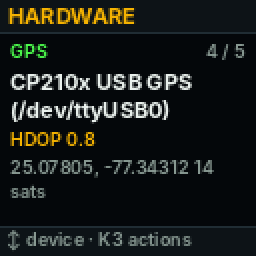
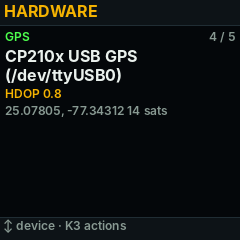

# First start and the GPS

[Back to the guide](README.md)

## Opening Quartermaster

Open **Quartermaster** from the launcher. A short animation of a ship plays first. Press any key to skip it. You can turn it off in **Settings > Boot animation**.

Then the menu shows eight tiles. Press the letter to jump straight to one:

| Key | Tile | What it is for |
| --- | --- | --- |
| **W** | Wardrive | Start a wardrive, or go back to the one running. |
| **R** | Recon | Look for cameras, trackers and other surveillance gear. See [Drive Alerts and Recon](alerts.md). |
| **L** | Logs | Your saved wardrives. |
| **U** | Uploads | What has been sent to WiGLE, WDGWars and Wardrift. |
| **H** | Hardware | Everything that is plugged in, and any problem with it. |
| **S** | Settings | See [Settings](settings.md). |
| **K** | Keys | Your upload keys. See [Uploads](uploads.md). |
| **A** | About | Version, credits, and **T** for tips. |

If you have not added any upload keys yet, a note says "Press K to add your upload keys".

## Check your hardware first

Plug in your GPS, and any Wi-Fi adapters you have. Then press **H** for the Hardware screen. It lists:

- each Wi-Fi adapter, with the bands it covers (2.4, 5 or 6 GHz),
- your GPS, which turns green once it has a fix,
- Bluetooth,
- nodes, the RTL-SDR stick and the Cap LoRa-1262 when you have them.

Scroll with **F** and **X**. If something shows in amber, see [Troubleshooting](troubleshooting.md).

You need no Wi-Fi adapter at all to start. The built-in Wi-Fi, Bluetooth and a GPS are a full wardriver.

## The GPS

Quartermaster works with:

- any USB GPS that sends standard NMEA data (for example u-blox or Quectel LC29H),
- the GPS on the Cap LoRa-1262,
- a Grove GPS unit,
- gpsd (a Linux program that shares a GPS between apps).

With **Settings > GPS source** on **Auto** (the default), Quartermaster finds the GPS by itself. It only switches on power for the cap and the Grove port when it needs them. You can plug a GPS in at any time, also during a wardrive.

The top right of every screen shows the GPS:

- **GPS** and a number (green): it has a fix, with that many satellites.
- **GPS --** (amber): a GPS is there but has no fix yet.
- **NO GPS** (amber): no GPS found.

A first fix can take a few minutes. Give the GPS a clear view of the sky, for example on the dashboard.

## Waiting for a GPS fix: nothing is logged until then

You can start a wardrive before the GPS has a fix. Until the first good fix, the wardrive waits:

- The radios start so that they are ready, but nothing is counted or logged, and no log file is made. Aircraft and mesh logs wait too.
- The screen says **Waiting for GPS fix**, with the GPS it is using and how many satellites it sees. With no GPS found, it tells you what to plug in.
- The top bar shows **GPS WAIT** instead of the timer.
- [Drive Alerts](alerts.md) already work, because they are there to warn you.

At the first fix, the timer starts at 00:00:00, the counters start from zero and the log opens.

"Good fix" means as good as **Settings > GPS accuracy needed** asks. The default is **Any fix**. A position also has to be fresh (under 5 seconds old) and the clock has to be set, so that WiGLE accepts every row.

If the fix is lost later in the drive, logging pauses and the screen says "GPS fix lost. Logging pauses until it is back." The timer keeps running.

If you stop a wardrive before there was ever a fix, nothing is saved. The summary says **Nothing: GPS never had a fix**.

## The country

Set **Settings > Country** to where you are if you use [nodes](nodes.md) or the [Cap LoRa-1262](aircraft-and-lora.md). It decides which Wi-Fi channels nodes may use and which LoRa band the cap listens on. Until you choose, Quartermaster uses United States. It asks you the first time you open **Settings > Nodes**, or start a wardrive with the cap fitted.

The country setting never changes the country (regulatory domain) of the Cardputer's own Wi-Fi adapters. See [Getting the most networks](more-networks.md).

## Your first wardrive

1. On the menu, press **W** (or **Space**).
2. Wait for the GPS fix. Then the counters show Wi-Fi networks, Bluetooth devices and rows logged.
3. Drive.
4. Press **OK**, then **OK** again to confirm. The wardrive stops and the log is saved. If you have added keys, it is uploaded once the Cardputer is online.

Next: [The wardrive screen and keys](wardrive.md).

## Battery

The battery level is at the top of every screen. You get a notice at 20 % and at 10 %.

At 5 %, off the charger for 15 seconds, a running wardrive is saved in full at once. It says "Battery 5%. Wardrive saved. Still recording." The wardrive keeps running and keeps saving every few seconds from then on, so a battery that gives out costs a few seconds at most. The next time Quartermaster opens, it finishes that log. Once a charger has been in for 15 seconds, the extra saving ends.

When the battery is almost empty (3 %), a running wardrive is saved and Quartermaster closes, so the Cardputer can switch off safely. If you plug in a charger in time, it stays open.

## On a DIY Raspberry Pi

**Opening Quartermaster.** A ready SD card image opens Quartermaster by itself each time the Pi starts. The first start of a new card takes a few minutes, and the Pi may restart once. After a manual install, the [DIY guide](../diy.md) shows how to make it start by itself. Any button skips the boot animation.

**The menu** is a list of the same eight items. Move through it with the joystick, and press the joystick or **K1** to open one. The line under the list tells you about the item you are on, as the tiles do on the CardputerZero. With a USB keyboard, the letters jump straight to an item. If you have not added any upload keys yet, a note says "Open Keys to add upload keys".

**The Hardware screen** shows one device at a time. Its place in the list is in the top right corner, such as "4 / 5". Move the joystick up and down to go through the devices.

| Waveshare 1.44inch LCD HAT | Waveshare 1.3inch LCD HAT |
| --- | --- |
|  |  |

**The GPS.** A Pi works with a USB GPS that sends standard NMEA data, or with gpsd. The Cap LoRa-1262 and the Grove port are parts of the CardputerZero. So on a Pi, **Settings > GPS source** has no **Cap / Grove** choice, and there is no **Cap and Grove power** setting. When no GPS is found, the Hardware screen says "Plug in a USB GPS or connect a receiver through gpsd." On a Zero, plug the GPS into the port marked **USB**. The port marked **PWR IN** is only for power.

**Where to see the GPS.** The Pi's small screen has no GPS mark at the top. On the menu, move to **Hardware**. The line under the list then says **GPS fix**, **GPS searching** or **No GPS**. When an adapter does not start, it says **Check adapter** instead. During a wardrive, the wardrive screen shows **GPS fix** or **No fix** beside the timer. While a wardrive waits for its first fix, it says **Waiting for GPS fix**, and on the menu the line under **Wardrive** says **No fix yet**.

**The country.** On a Pi, **Settings > Country** sets the Wi-Fi channels that nodes use and that [Deep scan](deep-scan.md) listens on. There is no LoRa band to set, because there is no LoRa cap. Quartermaster asks for it the first time you open **Settings > Nodes**, and never when a wardrive starts. The Pi's own Wi-Fi country is a setting of the Pi, not of Quartermaster. Set it in Raspberry Pi Imager, or as the [DIY guide](../diy.md) shows.

**Your first wardrive.** On the menu, choose **Wardrive** and press **OK**. To stop, press **OK**, then **OK** again, because **Stop + save** is picked first. See [the wardrive screen on a Pi](wardrive.md#on-a-diy-raspberry-pi).

**Battery.** A Pi has no battery of its own. The battery level shows at the top right only when the Pi's power supply reports a battery to Linux. Without one, there are no battery notices, and a running wardrive is not saved early at 5 % or 3 %. With one, the notices and the saving work as on the CardputerZero. When Quartermaster closes at 3 %, it stays closed until the Pi starts again.
