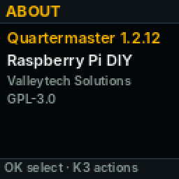
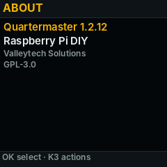

# Install and update

[Back to the guide](README.md)

This page is for the CardputerZero. The DIY version for a Raspberry Pi is installed in another way: see [On a DIY Raspberry Pi](#on-a-diy-raspberry-pi) at the end of this page.

## From the CardputerZero AppStore (easiest)

1. Open the **AppStore** app on the Cardputer.
2. Search for **Quartermaster**, or enter the share code **WARD**.
3. Install it.

To update later, open the AppStore app again. It lists the apps that have a newer version. Press **7** to update them.

**"Not found" (404) right after a new release.** This has been seen on a CardputerZero when a new version had just come out. Wait a few minutes and try again. (This is the AppStore, not Quartermaster. Quartermaster's own update check says "Could not check. Try again later." when it gets no proper answer.)

## With one command (newest version first)

New versions reach GitHub first and the AppStore after a review. To get the newest one now, open a terminal on the Cardputer, or connect to it over SSH (a way to type commands on it from another computer), and paste:

```sh
wget -qO /tmp/quartermaster.deb https://github.com/valleytechsolutions/Quartermaster/releases/latest/download/quartermaster.deb && sudo apt install -y /tmp/quartermaster.deb
```

The same command also updates Quartermaster.

### Use apt, not dpkg

Quartermaster needs a few other packages, for example `rtl-sdr` for aircraft and `usb-modeswitch` for some Wi-Fi adapters. `sudo apt install -y /tmp/quartermaster.deb` fetches those for you. The older command `sudo dpkg -i` does not, so parts of Quartermaster may not work. If you already used `dpkg -i`, run `sudo apt install -f` to fetch what is missing.

## After the first install: restart once

Restart the Cardputer once after the first install. The install gives your user new permissions (for the RTL-SDR stick, the Cap LoRa-1262, Bluetooth, the speaker and the radio helper). They only apply after a restart. Until then you may see messages such as "No permission yet. Restart the Cardputer once."

Then open **Quartermaster** from the launcher.

## Checking for updates

**Settings > Check for updates** asks the AppStore and GitHub if there is a newer version. Nothing is downloaded. You see one of these:

| Message | What it means |
| --- | --- |
| "X is ready. Open the AppStore and press 7 to update it." | The AppStore has a newer version. |
| "X is on GitHub. It reaches the AppStore after review." | Only GitHub has it so far. Use the one command above, or wait. |
| "You have the latest version (X)." | Nothing to do. |
| "Could not check. Is Wi-Fi connected?" | The Cardputer is not online. |
| "Could not check. Try again later." | A site did not answer properly. |

Press **OK** on that screen to check again.

## Removing Quartermaster

```sh
sudo apt remove quartermaster
```

Your logs and settings stay where they are. See [Files and logs](files.md).

## On a DIY Raspberry Pi

The AppStore and the one command above are only for the CardputerZero. The command always fetches the CardputerZero package from the release with GitHub's **Latest** badge, so do not run it on a Pi.

The DIY version comes from the Raspberry Pi releases on GitHub. Their tags start with `pi-v` and their names end in "for Raspberry Pi". They never have the **Latest** badge. A new Pi release is marked **Pre-release** until it has been tested. The release [Quartermaster 1.2.12 DIY for Raspberry Pi](https://github.com/valleytechsolutions/Quartermaster/releases/tag/pi-v1.2.12) has:

- a ready SD card image for each HAT: `quartermaster-pi-1.2.12-waveshare-1.44inch-lcd-hat.img.xz` and `quartermaster-pi-1.2.12-waveshare-1.3inch-lcd-hat.img.xz`,
- `quartermaster.rpi-imager-manifest`, a small file that opens Raspberry Pi Imager with both images in its list,
- the Pi package `quartermaster-pi_1.2.12_all.deb` and its checksums, for a card you already use.

### Flash a ready image (easiest)

Flash the image for your HAT with Raspberry Pi Imager. In Imager's list, choose "Quartermaster 1.2.12 for the Waveshare 1.44inch LCD HAT (128×128)" or "Quartermaster 1.2.12 for the Waveshare 1.3inch LCD HAT (240×240)". The [DIY guide](../diy.md#easiest-way-flash-a-ready-image) has every step.

- The Pi starts Quartermaster by itself. The first start takes a few minutes, and the Pi may restart once. You do not need to restart it yourself.
- The image logs in as user `pi` with password `pi`, and SSH is on. From a computer on the same network, type `ssh pi@quartermaster.local`. A user set in Raspberry Pi Imager replaces this login.
- Change the password right away. Log in, type `passwd` and follow the prompts.

### Install the Pi package on a card you already use

Follow [Assemble and install manually](../diy.md#assemble-and-install-manually) in the DIY guide. It ends with one restart, which also gives your user the new permissions. Until then you may see messages such as "No permission yet. Restart the Pi once."

### Checking for updates on a Pi

**Settings > Check for updates** asks GitHub for a newer Pi release. Nothing is downloaded. You see one of these:

| Message | What it means |
| --- | --- |
| "X is ready. Install the Pi package from GitHub." | A newer Pi release is out. |
| "Your Pi version (X) is up to date." | Nothing to do. |
| "Could not check. Is Wi-Fi connected?" | The Pi is not online. |
| "Could not find a Raspberry Pi release with an installer." | GitHub did not give a Pi release with its package. Try again later. |

Press **OK** on that screen to check again.

To update, install the new Pi package, or flash the newest image. **Updating** and **Flashing the newest image** under [Good to know](../diy.md#good-to-know) in the DIY guide show both ways. Flashing erases the card, and your settings and upload keys go with it. Before you flash, copy the `logs`, `recon` and `aircraft` folders to your computer, as the DIY guide shows.

To see which version runs on your Pi, open **About**.

| Waveshare 1.44inch LCD HAT | Waveshare 1.3inch LCD HAT |
| --- | --- |
|  |  |

### Removing the DIY version

```sh
sudo apt remove quartermaster-pi
```

Your logs and settings stay where they are. See [Files and logs](files.md#on-a-diy-raspberry-pi).
