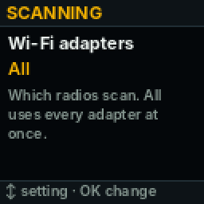
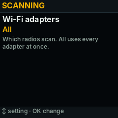

# Settings

[Back to the guide](README.md)

Press **S** on the menu. Move with **F** and **X**. The line at the bottom explains the setting you are on.

- **Z** and **C** step through the choices.
- **OK** opens a list of choices when there are more than two, or switches between the two.
- Settings marked with a list (such as **Nodes**) open their own screen.

Settings are saved at once. The settings in **Scanning**, **Deep scan**, **Logging** and **GPS** cannot be changed while a wardrive runs (except **Ignored networks**). Stop the wardrive first.

Defaults are shown in **bold**.

## Scanning

| Setting | Choices | What it does |
| --- | --- | --- |
| Wi-Fi adapters | **All**, USB only, Built-in only | Which Wi-Fi radios scan. All uses every adapter at once. |
| Wi-Fi bands kept | **All**, 2.4 GHz, 5 GHz, 6 GHz, 5 + 6 GHz | Networks on other bands are left out of the log. |
| Pause between sweeps | **None**, 1 s, 3 s, 10 s | A rest between scans. None finds the most. A pause saves battery. |
| Power guard | **On**, Off | Starts USB radios one by one and eases extra adapters when USB power runs short, so the GPS keeps going. See [Power](power.md). |
| USB hub power | **Auto**, Hub has power | Pick Hub has power if your USB hub has its own power supply plugged in, even if the hub says it does not. |
| Weakest signal kept | **Everything**, -90 dBm, -85 dBm, -80 dBm, -70 dBm | Ignores sightings weaker than this. (dBm is signal strength: -50 is strong, -90 is weak.) |
| Bluetooth scan | **On**, Off | Logs Bluetooth LE and classic devices. |
| Random BLE addresses | **Log**, Skip | Phones change their Bluetooth address often. Skip keeps logs smaller. |
| Bluetooth check | 0.5 s, **1 s**, 2 s, 5 s | How often Bluetooth results are read. |
| Aircraft (ADS-B) | **Auto**, On, Off | Logs aircraft with an RTL-SDR stick. Auto listens when one is plugged in. See [Aircraft](aircraft-and-lora.md). The [aircraft viewer](aircraft-and-lora.md#aircraft-viewer) on the Hardware screen works with any choice when no wardrive runs. |
| LoRa mesh | **Auto**, On, Off | Logs Meshtastic and MeshCore nodes with a Cap LoRa-1262. Auto listens when one is found. |
| Country | **United States**, 43 other countries, or Anywhere else | Where you are. Nodes use the Wi-Fi channels, and the cap the LoRa band, allowed there. |

## Deep scan

See [Deep scan and the radio helper](deep-scan.md) for the full story.

| Setting | Choices | What it does |
| --- | --- | --- |
| Deep scan | **Off**, On | A spare USB adapter listens quietly for Flock camera probes, disconnect floods, evil twins and every network it hears. 6 GHz stays covered. |
| Listen pattern | **Balanced**, Flock first | Balanced also covers busy 5 GHz channels. Flock first stays on channels 1, 6 and 11. |
| All adapters listen | **Auto**, Off | With 2 or more USB adapters that can listen, every spare one listens on its own channels. One adapter per band keeps normal scans. |
| Monitor adapter | **Auto**, or one of your USB adapters | Auto picks a spare adapter, and never the only 6 GHz one. |
| Direct scans | **Off**, On | USB adapters scan through Quartermaster's radio helper instead of NetworkManager, for fresher results. |
| Radio tuning | **Off**, During a wardrive | Power saving off and full legal transmit power on USB adapters, put back after. The country is never changed. |

If the radio helper is not ready, the help line says "Helper:" and what to do.

## Nodes

| Setting | What it does |
| --- | --- |
| Nodes | ESP32-C5 boards that scan Wi-Fi beside your adapters, on USB or wireless. Add, name or update them here. See [Nodes](nodes.md). |
| Flash a node | Puts the node firmware on an ESP32-C5 board, or updates a node. |
| Biscuit node | Makes Quartermaster a Pager 6 GHz node for a Biscuit or Biscuit Pro, with a 6 GHz USB adapter. Add it from a node search on the Biscuit. See [Biscuit node](biscuit.md). |

## Logging

| Setting | Choices | What it does |
| --- | --- | --- |
| Rows per device | **Closest + furthest**, Full track | Closest + furthest keeps two rows per device: its strongest and its weakest sighting. Full track adds rows as you move. |
| Log when signal changes | 2 dB, **4 dB**, 6 dB, 10 dB | Full track only. A sighting this much stronger or weaker adds a row. |
| Log again after moving | 10 m, **25 m**, 50 m, 100 m | Full track only. Extra rows as you move help WiGLE place the device. |
| Shortest time between rows | 5 s, 10 s, **30 s**, 60 s | Full track only. Per device. Lower means bigger logs. |
| Hidden networks | **Log**, Skip | Networks that do not send a name. |
| Ignored networks | A list (empty) | Names or addresses that are never written to a log, such as your home network. Up to 64. **A** adds, **D** removes. They still show on screen. You can also paste a long list on the [phone setup page](uploads.md). |

## GPS

| Setting | Choices | What it does |
| --- | --- | --- |
| GPS source | **Auto**, gpsd, USB (ttyUSB0), USB (ttyACM0), Cap / Grove, Off | Auto finds a USB, Cap LoRa or Grove GPS by itself. Off means nothing can be logged. |
| GPS accuracy needed | **Any fix**, Fair, Good, Best | Rows wait until the fix is at least this good. Fair, Good and Best mean an HDOP of 10, 5 and 2 or lower. (HDOP is a number for how precise the fix is. Lower is better.) |
| Cap and Grove power | **When needed**, Leave off | Switches on 5 V power for a GPS on the cap or the Grove port. |

## Uploads

| Setting | Choices | What it does |
| --- | --- | --- |
| Send logs | **Automatic**, Only when asked | Automatic sends finished logs whenever the Cardputer is online. See [Uploads](uploads.md). |

## Drive Alerts

See [Drive Alerts and Recon](alerts.md).

| Setting | Choices | What it does |
| --- | --- | --- |
| Alerts while wardriving | **On**, Off | Warns you about the devices you pick while you wardrive, from what the scan already hears. |
| Alert me about | A list | Which kinds of device alert, and the tone of each. By default: **Flock cameras, Axon body cams, Meta glasses and My alerts** (4 of 20). |
| Alert tones | **On**, Off | Off shows alerts on screen without a sound. |
| Tone volume | Loud, **Medium**, Quiet | How loud alert tones play, in wardrive alerts and in Recon. |
| Alert position | **Bottom**, Top | Where alert banners show, in wardrive alerts and in Recon. |
| Alert from | **Medium evidence**, Strong only, Weak hints | How sure Quartermaster must be before a wardrive alert. Weaker finds are still saved. |
| Alert again (moving devices) | **After 15 min**, After 1 h, Once per drive | When a body camera or other moving device may alert again after it has gone. Fixed cameras alert once per drive. |
| Only when signal is above | **Any**, -85 dBm, -75 dBm | Weaker finds are saved but do not alert. |
| My alerts | A list (empty) | Up to 8 Wi-Fi or Bluetooth names, patterns or MAC addresses that always alert, each up to 32 characters. A plain name matches every name that starts with it, `*` and `?` match any text, and capitals do not matter. **A** adds, **D** removes. See [My alerts](alerts.md#my-alerts). |
| No alerts for | A list (empty) | Up to 32 devices you silenced from an alert with **N**, such as your own glasses. They are still logged. **D** removes one. |

## Recon

| Setting | Choices | What it does |
| --- | --- | --- |
| Show devices from | **Weak hints**, Medium evidence, Strong only | The weakest evidence listed in Recon. |
| Alert from | **Medium evidence**, Strong only, Weak hints | Evidence needed before Recon alerts you. |
| Alert sound | **On**, Off | Beep when Recon raises an alert. |
| Watch list | A list | Kinds of device Recon looks for. By default 14 of 16: all but Proximity beacons and Smart speakers. |

## Screen

| Setting | Choices | What it does |
| --- | --- | --- |
| Live list shows | **Wi-Fi + BLE**, Wi-Fi, Bluetooth | What scrolls on the wardrive screen. |
| Start wardrive on launch | **No**, Yes | Skip the menu and start scanning. |
| Boot animation | **On**, Off | Show the ship at launch. |

## About

| Setting | What it does |
| --- | --- |
| Check for updates | Asks the AppStore and GitHub for a newer version. Nothing is downloaded. See [Install and update](install.md). |

## Where settings are kept

Settings are in `~/.config/quartermaster/config.json`, your upload keys in `~/.config/quartermaster/accounts.json`. Only your user can read them. See [Files and logs](files.md).

## On a DIY Raspberry Pi

The Settings screen shows one setting at a time. At the top is its section, such as **SCANNING**. Under it are the setting, its value and a line about it. Move the joystick up and down to go from setting to setting, and left or right to step through the choices. **OK** works as on the CardputerZero. During a wardrive, a setting that cannot be changed says "Stop the wardrive to change this."

| Waveshare 1.44inch LCD HAT | Waveshare 1.3inch LCD HAT |
| --- | --- |
|  |  |

What is different on a Pi:

- **LoRa mesh** and **Cap and Grove power** are not there, and **GPS source** has no **Cap / Grove** choice. They are for the Cap LoRa-1262 and the Grove port of the CardputerZero.
- **Alert me about** has no **LoRaWAN networks**, because LoRaWAN needs the cap. It lists 19 kinds, and 4 of them are on by default.
- **Country** sets the Wi-Fi channels that nodes use and that [Deep scan](deep-scan.md) listens on. There is no LoRa band to set. It does not change the Pi's own Wi-Fi country. See [First start](first-start.md#on-a-diy-raspberry-pi).
- **Send logs** on **Automatic** sends finished logs whenever the Pi is online.
- **Check for updates** asks GitHub for a newer Pi release. It does not ask the AppStore. See [Install and update](install.md#checking-for-updates-on-a-pi).
- The lists, such as **Ignored networks**, **My alerts** and **Alert me about**, show the CardputerZero layout. Their letter keys are in the **K3** list, such as **Add** and **Remove**. See [Drive Alerts](alerts.md#on-a-diy-raspberry-pi) for **Alert me about**.
- A ready SD card image keeps the settings in another folder. See [Files and logs](files.md#on-a-diy-raspberry-pi).
