# The wardrive screen and keys

[Back to the guide](README.md)

## Moving around

| Key | What it does |
| --- | --- |
| **F X Z C** or the arrow keys | Up, down, left, right (F, X, Z and C have arrows printed on them) |
| **OK** (Enter) | Open or confirm |
| **Esc** | Back |
| **Space** | On the menu: start or stop a wardrive |
| **W R L U H S K A** | On the menu: jump to Wardrive, Recon, Logs, Uploads, Hardware, Settings, Keys or About |
| **Esc** or **Q** on the menu | Quit Quartermaster. It asks first, with **Cancel** picked: move to **Quit** with **Z** or **C** and press **OK**, or press **Y** |

In a text box (for example when you type a key):

| Key | What it does |
| --- | --- |
| **Sym**, then a key | Types the symbol printed on that key |
| **Tab** | Opens a list of every symbol to pick from |
| **Del** | Erases |
| **OK** | Saves |
| **Esc** | Cancels |

## The wardrive screen

Start a wardrive with **W** or **Space** on the menu.

At the top are three counters:

- **WI-FI**: Wi-Fi networks heard.
- **BLUETOOTH**: Bluetooth devices heard.
- **LOGGED**: rows written to the log.

Under them:

- **2.4 GHz, 5 GHz, 6 GHz** with a number each: networks per band.
- **!3** (for example): alerts on this drive. Red when one of them is urgent. See [Drive Alerts](alerts.md).
- **Q 9m** (for example): alerts are quiet for 9 more minutes.
- **DEEP**: [Deep scan](deep-scan.md) is listening. **DEEPx3** means three adapters listen. **F2** means it heard Flock frames twice. This counts sightings, not cameras, so one camera can raise it several times.
- On the right: how many radios and nodes scan, and, when you have them, the number of aircraft and mesh nodes.

Below that, one line in amber or red appears when something needs your attention, such as "GPS fix lost. Logging pauses until it is back." See [Troubleshooting](troubleshooting.md).

The list at the bottom shows the newest devices heard. For Wi-Fi each row shows the band, the name ("(hidden)" when the network sends no name), the security, the channel and the signal strength. Bluetooth rows show **BT**. Networks on your ignore list show **IGNORED** and are never written to the log.

## Keys on the wardrive screen

| Key | What it does |
| --- | --- |
| **OK** or **S** | Stop the wardrive. It asks first. Press **OK** again to stop and save. Or choose **Stop, don't save**. |
| **Tab** (or **Z** / **C**) | Show Wi-Fi and Bluetooth, only Wi-Fi, or only Bluetooth |
| **A** | The alerts of this wardrive (when Drive Alerts are on) |
| **Q** | No alert tones or banners for 10 minutes. Press again to end it |
| **Del** | Hide the alert banner on screen. With no banner showing, Del goes back like Esc |
| **Esc** | Back to the menu. The wardrive keeps running. Press **W** to come back to it |

While the wardrive waits for a GPS fix, **OK** shows "Stop" instead of "Stop + save", because there is nothing to save yet.

Settings in the Scanning, Deep scan, Logging and GPS sections cannot be changed during a wardrive. Settings says "Stop the wardrive to change this setting." All other settings, such as Drive Alerts, change at once.

Recon and a wardrive never run together. If you start one while the other runs, Quartermaster asks first and stops the other.

## Stopping without saving

For a test drive you do not want to keep, the stop question has three choices: **Cancel**, **Stop + save** and **Stop, don't save**. "Stop + save" is the one selected, so pressing **OK** twice always saves.

1. Press **OK** on the wardrive screen.
2. Press **C** (or move right) to **Stop, don't save**, then **OK**.
3. It asks "Throw away this wardrive?" and says how many networks will be lost. Choose **Throw away** and press **OK**.

That wardrive's log, summary, aircraft, mesh and alert files are removed from the device, and nothing more of it is uploaded. Files from earlier wardrives are not touched. This cannot be undone.

On a very long drive the log is split into parts of 8 MB, and a finished part may be uploaded while you still drive. Such a part stays on the upload site. The question then says "Parts already uploaded stay on the upload sites", and the notice after it says "Uploaded parts stay on the sites."

If a file could not be removed, the notice says "Some files of this wardrive could not be removed". What stays can come back as a log the next time Quartermaster starts. Delete it then on the Logs screen.

On a DIY Raspberry Pi, the stop question looks different. See [Stopping on a Pi](#stopping-on-a-pi).

## Low battery

At 5 % battery, off the charger, a running wardrive is saved in full at once and keeps recording. See [Battery](first-start.md#battery).

## When you stop

The summary shows the numbers of the drive and the file it was saved as. It also says what happens next, for example "Uploading to WiGLE, WDGWars." or "Press K to add your upload keys."

| Key | What it does |
| --- | --- |
| **L** | Logs |
| **U** | Uploads |
| **K** | Keys |
| **W** | Start a new wardrive |
| **Esc** or **OK** | Back to the menu |

If Drive Alerts found something, a short note lists the alerts of the drive.

## Logs screen

Each saved log shows its date and size, and one dot per upload site (WiGLE, WDG, DRIFT):

- green dot: sent,
- amber ring: waiting to be sent,
- red dot: refused (open the log to see why),
- dash: this file is not for that site (aircraft and mesh files never go to WiGLE),
- thin empty ring: no key saved for that site.

**AIR** marks an aircraft file, **MESH** a mesh file, **REC** the log being written now.

Keys: **OK** opens a log, **U** uploads now. In a log: **U** sends it again, **D** deletes it.

## Starting a wardrive by itself

Set **Settings > Start wardrive on launch** to **Yes** and Quartermaster skips the menu and starts scanning when it opens.

## On a DIY Raspberry Pi

### The keys on a Pi

| On the CardputerZero | On a DIY Raspberry Pi |
| --- | --- |
| **F X Z C** or the arrow keys | Move the joystick |
| **OK** (Enter) | Press the joystick, or press **K1** |
| **Esc** | **K2** |
| A letter key, **Space**, **Tab** or **Del** | Press **K3** and choose from the list |

**K3** opens a list of the actions of the screen you are on, which the CardputerZero has on letter keys. While an alert shows, the list also has **Dismiss alert**, and during a wardrive **Quiet 10 min**. On most screens it ends with **Pan details** (see below). Move to an action and press **OK**. **K2** or **K3** closes the list.

A USB keyboard works on the Pi too, with the same keys as on the CardputerZero. **Tab** and the keys for up and down work differently, to match the HAT. **Tab** does what **K3** does. Up and down, on the arrow keys or on **F** and **X**, do what the joystick does: on the menu they move one item at a time, and in a question, such as "Stop the wardrive?", they show more of the text. There, only left and right change the choice. Plug the keyboard in before you switch the Pi on, because Quartermaster looks for a keyboard only when it starts.

### What fits on the small screen

The screens you use most have their own layout for the small square screen: the menu, the wardrive screen, the stop question, Hardware, Settings, Logs, Keys, the phone setup, text boxes and the aircraft viewer, among others. Other screens, such as the summary, Uploads, Recon and the alert list, show the CardputerZero screen at its real size, so only a part of it fits. On those screens the joystick moves through the list as usual. To see the rest, press **K3** and choose **Pan details**. Then move the joystick to look across the screen, and press **K2** when you are done.

### The menu on a Pi

Choose **Wardrive** and press **OK** to start a wardrive. **K3** on the menu offers **Start wardrive**, and **Stop wardrive** while one runs.

**K2** on the menu asks "Quit Quartermaster?", with **Cancel** picked. If you move to **Quit** and press **OK**, Quartermaster closes. It stays closed until the Pi starts again.

### The wardrive screen on a Pi

At the top are the timer and **GPS fix** or **No fix**. Under them are three counts: **Wi-Fi**, **Bluetooth** and **Rows** (rows written to the log). Below them are the aircraft and nodes when you have them, and the newest devices heard. When something is wrong, a warning shows there instead, such as "GPS fix lost. Logging pauses until it is back." The band counts, **DEEP** and the alert count are only on the CardputerZero layout. To see them, press **K3** and choose **Pan details**.

| On a DIY Raspberry Pi | What it does |
| --- | --- |
| **OK** | Stop the wardrive. It asks first. |
| Joystick left or right, or **K3** and then **Filter** | Show Wi-Fi and Bluetooth, only Wi-Fi, or only Bluetooth |
| **K3**, then **Alerts** | The alerts of this wardrive (when Drive Alerts are on) |
| **K3**, then **End quiet** | End a quiet time early |
| **K3**, then **Dismiss alert** or **Quiet 10 min** | Only while an alert shows. See [Drive Alerts](alerts.md#on-a-diy-raspberry-pi). |
| **K2** | Back to the menu. The wardrive keeps running. Choose **Wardrive** again to come back to it. |

The pictures show a wardrive and its **K3** list. The 1.44inch HAT is drawn at twice its size.

| Waveshare 1.44inch LCD HAT | Waveshare 1.3inch LCD HAT |
| --- | --- |
| 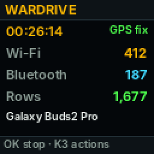 | 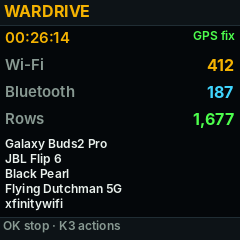 |
| 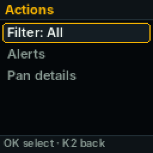 | 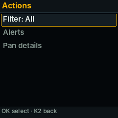 |

### Stopping on a Pi

The stop question shows one choice at a time, with what that choice does. **Stop + save** comes first, so **OK** again saves the drive. Move the joystick right for **Stop, don't save**, and left for **Cancel**. When the text is long, move the joystick up and down to read all of it.

**Stop, don't save** asks once more, with **Cancel** picked. Move right to **Throw away** and press **OK**.

| Waveshare 1.44inch LCD HAT | Waveshare 1.3inch LCD HAT |
| --- | --- |
| 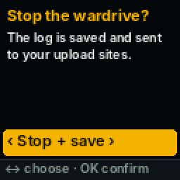 | 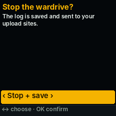 |
| 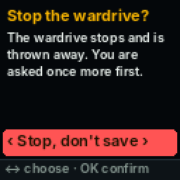 | 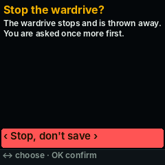 |

### Typing in a text box on a Pi

Press **K3** to open a keyboard on the screen. Move to a character with the joystick, and press **OK** to type it. **⌫** erases a character and **✓** saves. **K3** or **K2** closes the keyboard. With the keyboard closed, **OK** saves and **K2** cancels. A USB keyboard types straight into the box.

| Waveshare 1.44inch LCD HAT | Waveshare 1.3inch LCD HAT |
| --- | --- |
| 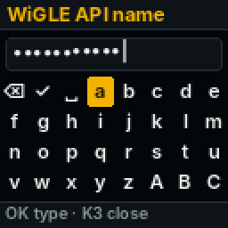 | 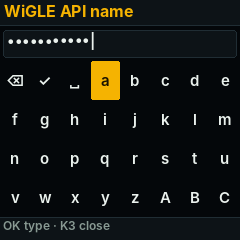 |

### The summary and the Logs screen on a Pi

The summary shows the CardputerZero layout. **K3** offers **Logs**, **Uploads** and **New wardrive**. **OK** or **K2** goes back to the menu. When the summary says "Press K to add your upload keys.", go back to the menu and open **Keys**.

The Logs screen lists your logs by date. The line under the list shows the size of the log you are on, with **REC** for the log being written now. **K3** offers **Upload now**. The upload dots are only on the CardputerZero layout: press **K3** and choose **Pan details**. **OK** opens a log, and there **K3** offers **Upload again** and **Delete**.

| Waveshare 1.44inch LCD HAT | Waveshare 1.3inch LCD HAT |
| --- | --- |
| 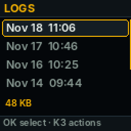 | 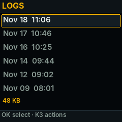 |
